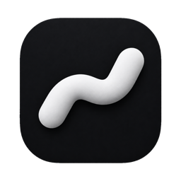
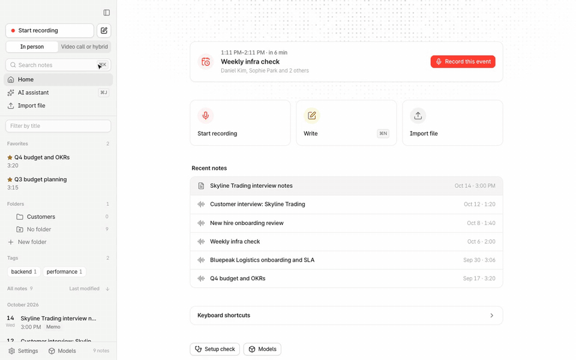
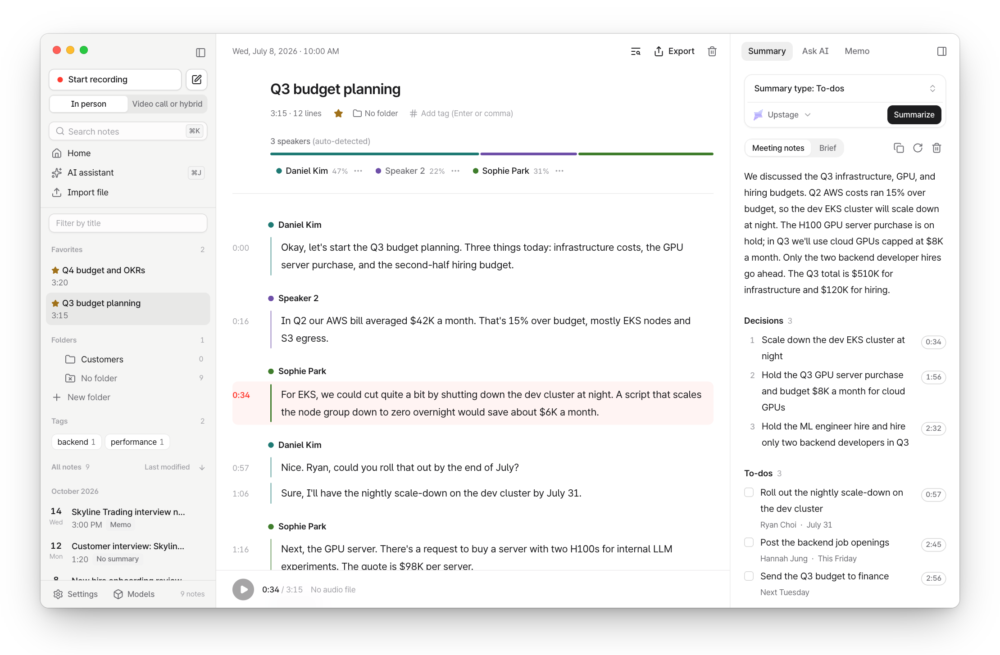
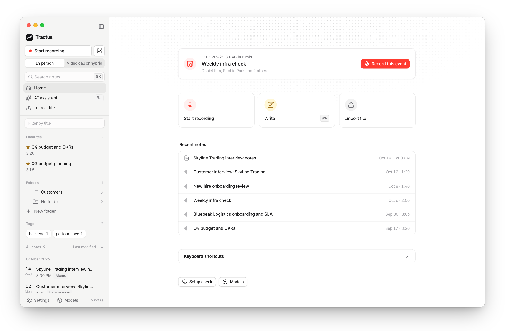
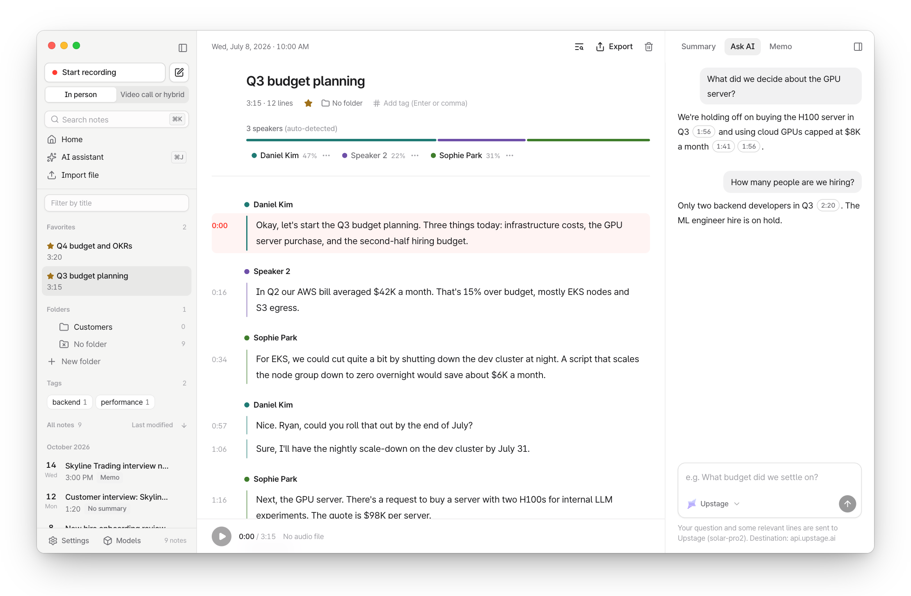
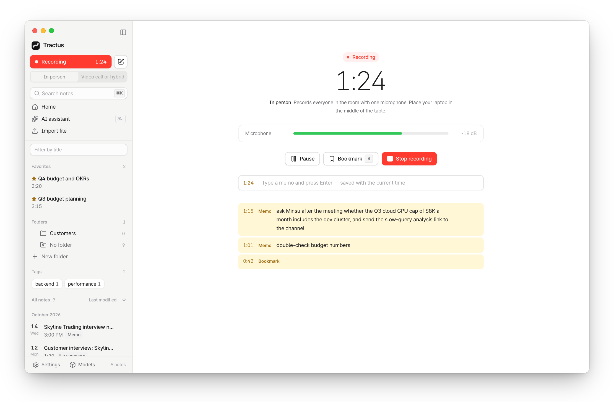
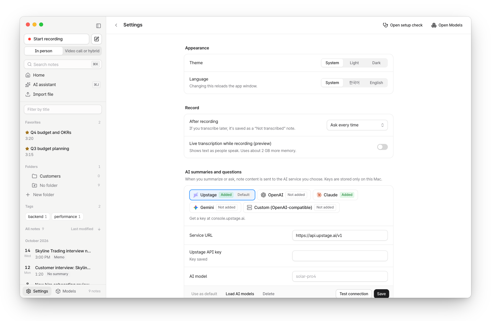

<a id="readme-top"></a>

<div align="center">



# Tractus

**A local-first AI notes app for macOS that turns your recordings and memos into searchable, citable memory — for you and for your AI agents.**

Speech recognition, speaker detection and search run on your Mac (Apple Silicon, MLX). Audio never leaves the device, and every note is a plain file you own.

[![Release][release-shield]][release-url] [![License][license-shield]][license-url] [![macOS][macos-shield]][setup-url] [![Local-first][local-shield]][how-url]

**English** · [한국어](README.ko.md)

[**Download**](https://github.com/sjoon21/Tractus/releases/latest) · [Setup](docs/en/setup.md) · [Usage](docs/en/usage.md) · [How it works](docs/en/how-it-works.md) · [Roadmap](docs/roadmap.md)

<br>



<sub>Recorded note → <b>Enhance</b> (my memo + transcript) → <b>ask Claude Code about the meeting</b> (sample data)</sub>

</div>

## Why Tractus

- 🔒 **Everything heavy runs locally.** Recording, transcription, speaker detection and smart search run on-device with MLX. No audio is uploaded, and recording, transcription and search work without any API key.
- 🤖 **Meeting memory for AI agents.** A built-in MCP server and a one-line Claude Code plugin let Claude Code, Codex and other agents search your notes and answer with citations like `[Weekly dev sync 00:02:11]`.
- 🧾 **Every claim points back to the audio.** Each summary item, to-do and AI answer links to the exact moment in the recording — click to listen.
- 📁 **Plain files you own.** Notes live in `~/Tractus/meetings/` as audio, JSON, Markdown and subtitles. Send any note to Obsidian with one click.
- 🎯 **Measured, not guessed.** We benchmarked on-device models on real meetings: Qwen3-ASR-1.7B made 36% fewer character errors than Whisper-large-v3-turbo on Korean meetings (CER 9.49 vs 14.92) and fewer word errors on English meetings (AMI WER 9.50 vs 14.28), transcribing an hour of audio in 8.2 minutes on an M3 ([benchmark](docs/benchmark.md)).

## Features

- **Record anything** — in-person (microphone) or video calls (microphone + system audio), pause/resume, memos and bookmarks while recording, quick recording from the menu bar
- **On-device transcription** — Qwen3-ASR on Apple MLX with automatic language detection (Korean, English and more); drop in audio or video files
- **Speakers** — automatic speaker detection, rename speakers, and optional voice profiles that suggest names in later recordings
- **Word sync** — the spoken word highlights during playback; click any word to jump there
- **Enhanced notes** — write rough memos while recording, and Tractus fills in the details from the transcript
- **Summaries** — meeting minutes, brief, to-dos, lecture, interview, ideas, or your own instructions
- **Ask AI** — ask one note or all of your notes; answers cite the lines they're based on
- **Smart search** — word match plus similar-meaning search across every note (⌘K)
- **Organize and export** — favorites, tags, folders; TXT, Markdown, SRT, VTT, CSV, DOCX, PDF, full backup (ZIP), and Send to Obsidian
- **Calendar** — upcoming events from macOS Calendar appear on Home; record with the event title, and attendee names help recognition
- **Native feel** — light and dark mode, English and Korean UI, in-app updates

## Screenshots

<picture>
  <source media="(prefers-color-scheme: dark)" srcset="docs/images/en/note-dark.png">
  
</picture>

<table>
  <tr>
    <td width="50%">
      <picture>
        <source media="(prefers-color-scheme: dark)" srcset="docs/images/en/home-dark.png">
        
      </picture>
      <p align="center"><b>Home</b> — record, write, import, recent notes</p>
    </td>
    <td width="50%">
      <picture>
        <source media="(prefers-color-scheme: dark)" srcset="docs/images/en/ask-dark.png">
        
      </picture>
      <p align="center"><b>Ask AI</b> — every answer cites the transcript</p>
    </td>
  </tr>
  <tr>
    <td width="50%">
      <picture>
        <source media="(prefers-color-scheme: dark)" srcset="docs/images/en/record-dark.png">
        
      </picture>
      <p align="center"><b>Record</b> — level meter, bookmarks, timestamped memos</p>
    </td>
    <td width="50%">
      <picture>
        <source media="(prefers-color-scheme: dark)" srcset="docs/images/en/settings-dark.png">
        
      </picture>
      <p align="center"><b>Settings</b> — appearance and language, recording, AI services, models</p>
    </td>
  </tr>
</table>

> Screenshots use made-up sample data.

## Quick start

1. Download `Tractus-…-arm64.dmg` from [Releases](https://github.com/sjoon21/Tractus/releases/latest) and drag `Tractus.app` into `Applications`.
2. Install ffmpeg:
   ```bash
   brew install ffmpeg
   ```
3. Open the app. The **setup check** walks you through downloading the on-device models and (optionally) adding an AI service key for summaries and Ask AI.

> [!NOTE]
> This build isn't signed or notarized by Apple yet. If macOS says the developer can't be verified, go to System Settings › Privacy & Security and click `Open Anyway`. Building from source and troubleshooting are covered in [Setup](docs/en/setup.md).

**Requirements:** Apple Silicon (M1 or later), macOS 14.4+, 16 GB memory recommended (8 GB works with the lite models).

### Ask Claude Code about your meetings

With the app installed, add one plugin to Claude Code — no paths or environment variables to set up:

```
/plugin install tractus --marketplace sjoon21/Tractus
```

```text
> When did we decide to ship the release?
The release moved to October 22 — a week later than planned, because of the payment
API issue and too little QA time. [Weekly dev sync 00:02:11]
```

The plugin bundles the MCP tools (search, transcripts, summaries, to-dos), a meeting-memory skill, and `/tractus:recap last week` for a period recap. Your notes stay on your Mac; only what Claude reads is sent to Claude. See [Agents (MCP)](docs/en/mcp.md).

## Privacy

| Data | Where it goes |
| --- | --- |
| Audio, speaker voice profiles | Stays on your Mac. Never uploaded. |
| Notes, metadata, search data | Local files (`~/Tractus/meetings/`) and a local SQLite database |
| Summaries and Ask AI | Only the needed text is sent to the AI service you choose (Upstage, OpenAI, Claude, Gemini, or any OpenAI-compatible API — including one running on your Mac) |

Without any AI key you can still record, transcribe, detect speakers, search and export. Details: [How it works](docs/en/how-it-works.md).

## Documentation

User guides are in English; the developer docs (CLI, models, benchmark, architecture) are in Korean for now.

| Doc | What's in it |
| --- | --- |
| [Setup](docs/en/setup.md) | Installer, building from source, permissions, updates, troubleshooting |
| [Usage](docs/en/usage.md) | Creating notes, speakers and editing, summaries and Ask AI, shortcuts |
| [AI services and keys](docs/en/ai-services.md) | Configuring AI services, default models, smart search options |
| [Models and licenses](docs/models.md) (Korean) | Model downloads, list and licenses, why these models |
| [CLI](docs/cli.md) (Korean) | The `tractus` command line: transcribe, summarize, ask, search, export |
| [Speech recognition benchmark](docs/benchmark.md) (Korean) | Qwen3-ASR vs Whisper vs Nemotron on Korean and English meetings |
| [Agents (MCP)](docs/en/mcp.md) | Claude Code plugin, Codex and other agents, the 7 MCP tools |
| [How it works](docs/en/how-it-works.md) | Architecture, what stays local and what leaves your Mac |
| [Architecture](ARCHITECTURE.md) (Korean) | Design decisions, change log, benchmark results |
| [Roadmap](docs/roadmap.md) (Korean) | What's done, what's next, known limits |
| [Contributing](CONTRIBUTING.md) (Korean) | Dev setup, tests, commit rules |

## Tech stack

[![Python][python-badge]][python-url] [![MLX][mlx-badge]][mlx-url] [![Tauri][tauri-badge]][tauri-url] [![React][react-badge]][react-url] [![Tailwind][tailwind-badge]][tailwind-url] [![Swift][swift-badge]][swift-url] [![SQLite][sqlite-badge]][sqlite-url] [![MCP][mcp-badge]][mcp-url]

The core CLI and pipeline are Python; on-device inference (speech recognition, speaker detection, embeddings) uses Apple MLX; the desktop app is Tauri 2 (Rust + React); system audio capture is a small Swift helper.

## Contributing

Bug reports and ideas are welcome in [GitHub Issues](https://github.com/sjoon21/Tractus/issues). For code, start with [Contributing](CONTRIBUTING.md).

## License

[Apache License 2.0](LICENSE). Each bundled or downloaded model has its own license — see [NOTICE](NOTICE) and [Models and licenses](docs/models.md).

<p align="right"><a href="#readme-top">Back to top ↑</a></p>

[release-shield]: https://img.shields.io/github/v/release/sjoon21/Tractus?style=for-the-badge&color=blue
[release-url]: https://github.com/sjoon21/Tractus/releases/latest
[license-shield]: https://img.shields.io/badge/license-Apache--2.0-blue?style=for-the-badge
[license-url]: LICENSE
[macos-shield]: https://img.shields.io/badge/macOS-Apple_Silicon-000000?style=for-the-badge&logo=apple&logoColor=white
[setup-url]: docs/en/setup.md
[local-shield]: https://img.shields.io/badge/local--first-audio_stays_on_Mac-2ea44f?style=for-the-badge
[how-url]: docs/en/how-it-works.md
[python-badge]: https://img.shields.io/badge/Python-3776AB?style=flat&logo=python&logoColor=white
[python-url]: https://www.python.org
[mlx-badge]: https://img.shields.io/badge/MLX-000000?style=flat&logo=apple&logoColor=white
[mlx-url]: https://github.com/ml-explore/mlx
[tauri-badge]: https://img.shields.io/badge/Tauri_2-24C8D8?style=flat&logo=tauri&logoColor=white
[tauri-url]: https://tauri.app
[react-badge]: https://img.shields.io/badge/React-149ECA?style=flat&logo=react&logoColor=white
[react-url]: https://react.dev
[tailwind-badge]: https://img.shields.io/badge/Tailwind_CSS-06B6D4?style=flat&logo=tailwindcss&logoColor=white
[tailwind-url]: https://tailwindcss.com
[swift-badge]: https://img.shields.io/badge/Swift-F05138?style=flat&logo=swift&logoColor=white
[swift-url]: https://www.swift.org
[sqlite-badge]: https://img.shields.io/badge/SQLite-003B57?style=flat&logo=sqlite&logoColor=white
[sqlite-url]: https://www.sqlite.org
[mcp-badge]: https://img.shields.io/badge/MCP-111111?style=flat
[mcp-url]: https://modelcontextprotocol.io
