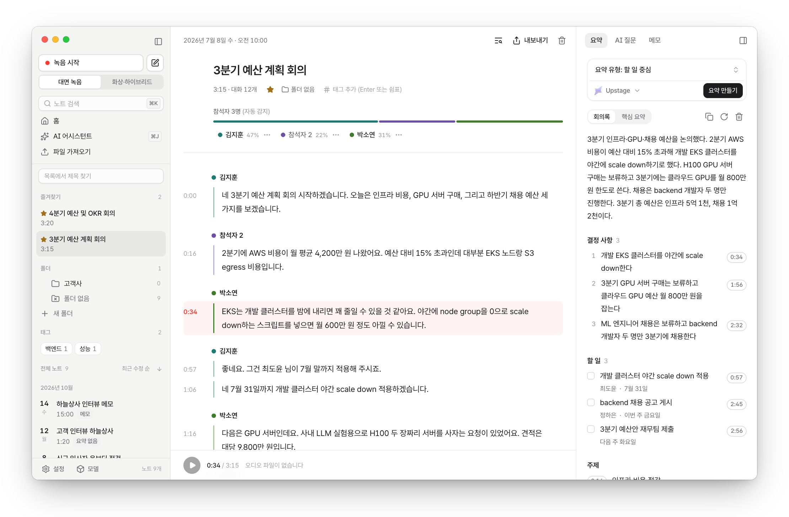
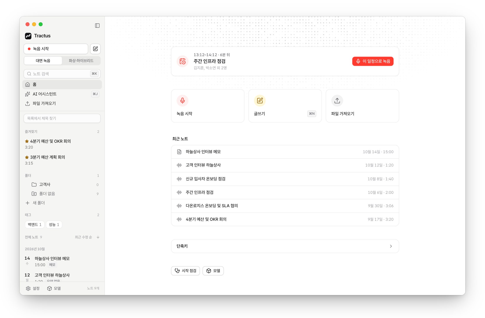
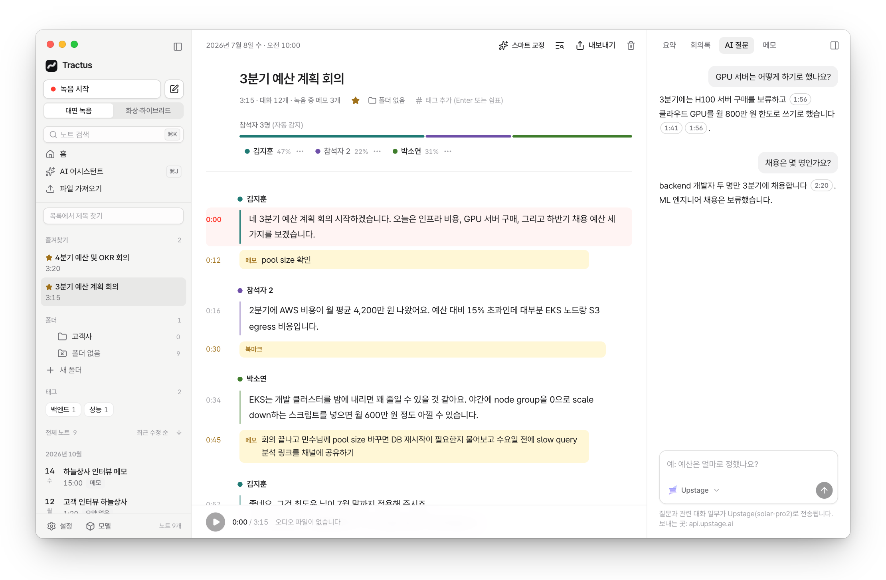
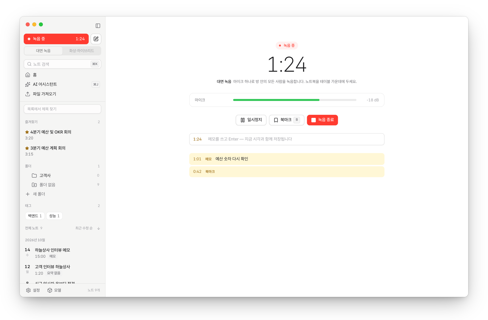
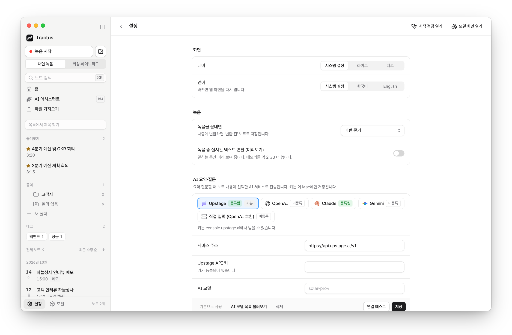

<a id="readme-top"></a>

<div align="center">


# Tractus

**음성 녹음과 메모를 온디바이스(로컬)에서 텍스트로 변환하고, 요약·검색·AI 질의응답까지 지원하는 로컬 우선 AI 노트 앱**

오디오 데이터는 로컬 환경에만 안전하게 보관되며, 모든 노트는 파일 시스템에 직접 소유할 수 있는 파일로 저장됩니다.

[![Release][release-shield]][release-url] [![License][license-shield]][license-url] [![macOS][macos-shield]][setup-url] [![Local-first][local-shield]][how-url]

[**다운로드**](https://github.com/sjoon21/Tractus/releases/latest) · [설치 안내](docs/setup.md) · [사용법](docs/usage.md) · [동작 방식](docs/how-it-works.md) · [로드맵](docs/roadmap.md)

<br>

<picture>
  <source media="(prefers-color-scheme: dark)" srcset="docs/images/note-dark.png">
  
</picture>

</div>

## 핵심 특징

- 🔒 **100% 로컬 처리 제공** — 음성 녹음, 텍스트 변환(STT), 화자 분리, 벡터 검색이 Apple Silicon 온디바이스(MLX)에서 직접 실행되며, 오디오 데이터를 외부 서버로 전송하지 않습니다.
- 📁 **로컬 파일 기반 저장** — 모든 노트는 `~/Tractus/meetings/` 내의 표준 파일(오디오·JSON·Markdown·자막)로 관리되어 사용자가 데이터를 온전히 소유하며, Obsidian 등 원하는 도구와 자유롭게 연동됩니다.
- 🧾 **타임스탬프 연동 요약** — 회의 결정 사항 및 액션 아이템마다 원본 대화 타임스탬프가 링크되어, 클릭 한 번으로 해당 오디오 구간을 즉시 다시 들을 수 있습니다.
- 🤖 **AI 에이전트 연동 (MCP 지원)** — Model Context Protocol(MCP) 서버를 기본 내장하여 Claude Code, Codex, Antigravity 등의 AI 에이전트가 로컬 노트를 직접 검색하고 인용할 수 있습니다.

## 주요 기능

- **유연한 음성 녹음** — 대면 마이크 녹음, 화상 회의 시스템 오디오 캡처, 녹음 일시정지, 실시간 메모 및 북마크, 메뉴바 빠른 녹음
- **온디바이스 음성 인식(STT)** — Apple MLX 기반 Qwen3-ASR 모델로 한국어·영어 자동 감지, 오디오 및 동영상 파일 드래그 앤 드롭 변환
- **화자 분리 및 식별 (Diarization)** — 음성 특징 기반 화자 분리 및 프로필 등록을 통한 화자 자동 인식/제안
- **단어 단위 오디오 싱크 (Word-level Alignment)** — 재생 중인 단어 실시간 하이라이트 및 단어 클릭 시 해당 위치 즉시 탐색/재생
- **다양한 AI 요약** — 회의록, 핵심 요약, 할 일 중심 등 6가지 기본 템플릿 및 사용자 정의(커스텀) 프롬프트 요약 지원
- **AI 질의응답 (Q&A)** — 단일 노트 또는 전체 노트를 대상으로 한 자연어 질의응답 및 원본 발화 타임스탬프 근거 제공
- **하이브리드 검색** — 키워드 정확 일치(BM25/FTS5) 및 시맨틱 벡터 유사도 결합 검색 (⌘K)
- **정리 및 내보내기** — 즐겨찾기, 태그, 폴더 관리 / TXT, MD, SRT, VTT, CSV, DOCX, PDF 및 전체 백업(ZIP) 지원, Obsidian 볼트로 보내기
- **캘린더 연동** — macOS 캘린더의 곧 시작하는 일정을 홈에 보여 주고, 일정 제목과 참석자 이름으로 바로 녹음
- **네이티브 UI/UX** — 라이트·다크 모드, macOS 네이티브 인터페이스, 인앱 자동 업데이트

## 스크린샷

<table>
  <tr>
    <td width="50%">
      <picture>
        <source media="(prefers-color-scheme: dark)" srcset="docs/images/home-dark.png">
        
      </picture>
      <p align="center"><b>홈</b> — 녹음·작성·가져오기와 최근 노트 목록</p>
    </td>
    <td width="50%">
      <picture>
        <source media="(prefers-color-scheme: dark)" srcset="docs/images/ask-dark.png">
        
      </picture>
      <p align="center"><b>AI 질의응답</b> — 답변마다 원본 대화 타임스탬프 근거 제공</p>
    </td>
  </tr>
  <tr>
    <td width="50%">
      <picture>
        <source media="(prefers-color-scheme: dark)" srcset="docs/images/record-dark.png">
        
      </picture>
      <p align="center"><b>녹음</b> — 오디오 레벨 미터, 북마크, 타임스탬프 메모</p>
    </td>
    <td width="50%">
      <picture>
        <source media="(prefers-color-scheme: dark)" srcset="docs/images/settings-dark.png">
        
      </picture>
      <p align="center"><b>설정</b> — 테마, 녹음, AI 서비스 및 모델 설정</p>
    </td>
  </tr>
</table>

> 스크린샷은 가상 회의 데이터로 생성되었습니다.

## 빠른 시작

1. [릴리스](https://github.com/sjoon21/Tractus/releases/latest)에서 `Tractus-…-arm64.dmg`를 다운로드하여 `Tractus.app`을 `Applications` 폴더로 끌어다 놓습니다.
2. 터미널에서 ffmpeg를 설치합니다.
   ```bash
   brew install ffmpeg
   ```
3. 앱을 실행하면 **초기 설정 마법사(Setup Doctor)**가 온디바이스 모델 다운로드 및 AI 서비스 설정을 안내합니다.

> [!NOTE]
> 아직 Apple 서명 및 공증을 받지 않은 빌드입니다. 처음 실행 시 "확인되지 않은 개발자" 경고가 나타나면 시스템 설정 › 개인정보 보호 및 보안 › `그래도 열기`를 클릭하세요. 소스 코드 직접 빌드 방법과 문제 해결은 [설치 안내](docs/setup.md)에서 확인할 수 있습니다.

**요구 사양:** Apple Silicon(M1 이상), macOS 14.4 이상, 권장 메모리 16GB (8GB 환경은 경량 구성 권장)

## 데이터 처리 및 프라이버시 정책

| 데이터 구분 | 처리 및 저장 위치 |
| --- | --- |
| 음성 오디오, 화자 음성 프로필 | 로컬 기기 내에서만 처리 및 보관 (외부 전송 없음) |
| 노트 원본, 메타데이터, 검색 색인 | 로컬 파일 시스템(`~/Tractus/meetings/`) 및 SQLite DB |
| 요약 및 AI 질문 요청 | 사용자가 설정한 AI 서비스로 필요한 텍스트만 전송 (Upstage·OpenAI·Claude·Gemini·OpenAI 호환 API) |

외부 AI 서비스 API 키가 없어도 녹음, 음성 인식(STT), 화자 분리, 로컬 검색, 파일 내보내기 등 핵심 기능은 온디바이스에서 완전히 동작합니다. 자세한 데이터 흐름은 [동작 방식](docs/how-it-works.md#무엇이-이-mac에-남고-무엇이-나가는가)에서 확인하실 수 있습니다.

## 문서

| 문서 | 내용 |
| --- | --- |
| [설치 안내](docs/setup.md) | 설치 프로그램 배포판, 소스 빌드, 시스템 권한, 자동 업데이트, 문제 해결 |
| [사용법](docs/usage.md) | 노트 생성, 화자 관리 및 대화 편집, 요약·AI 질의응답, 단축키 |
| [AI 서비스와 키](docs/ai-services.md) | AI 서비스 설정, 서비스별 기본 모델, 검색 임베딩 설정 |
| [모델과 라이선스](docs/models.md) | 모델 다운로드, 모델 목록 및 라이선스, 기술 선정 근거 |
| [CLI](docs/cli.md) | 터미널 CLI 도구(변환·요약·질문·검색·내보내기) 사용법 |
| [에이전트 연동 (MCP)](docs/mcp.md) | Claude Code·Codex·Antigravity 연동 설정 및 제공 도구(7개) 안내 |
| [동작 방식](docs/how-it-works.md) | 시스템 구성 아키텍처, 로컬 처리 및 외부 전송 데이터 흐름 |
| [아키텍처](ARCHITECTURE.md) | 설계 결정 사유, 변경 이력, 벤치마크 결과 |
| [앱 계약](docs/desktop.md) · [디자인 지침](app/DESIGN.md) | 데스크톱 앱과 코어 간 인터페이스 계약, 화면 UI/UX 규칙 |
| [로드맵](docs/roadmap.md) | 개발 로드맵, 진행 현황 및 알려진 한계점 |
| [기여 안내](CONTRIBUTING.md) | 개발 환경 구축, 테스트 실행, 커밋 및 기여 규칙 |

## 기술 스택 (Tech Stack)

[![Python][python-badge]][python-url] [![MLX][mlx-badge]][mlx-url] [![Tauri][tauri-badge]][tauri-url] [![React][react-badge]][react-url] [![Tailwind][tailwind-badge]][tailwind-url] [![Swift][swift-badge]][swift-url] [![SQLite][sqlite-badge]][sqlite-url] [![MCP][mcp-badge]][mcp-url]

코어 CLI 및 파이프라인은 Python, 온디바이스 모델 추론(음성 인식·화자 분리·임베딩)은 Apple MLX, 데스크톱 앱은 Tauri 2(Rust + React), 시스템 오디오 캡처 모듈은 Swift로 구현되었습니다. 세부 아키텍처는 [동작 방식](docs/how-it-works.md)을 참조하세요.

## 기여 및 문의

버그 리포트, 기능 제안, 문의 사항은 [GitHub Issues](https://github.com/sjoon21/Tractus/issues)에 남겨 주세요. 코드 기여를 원하시는 분은 [기여 안내](CONTRIBUTING.md)를 먼저 확인해 주시기 바랍니다.

## 라이선스

본 프로젝트는 [Apache License 2.0](LICENSE) 라이선스를 따릅니다. 포함된 각 AI 모델의 개별 라이선스 및 고지 사항은 [NOTICE](NOTICE) 및 [모델과 라이선스](docs/models.md)를 참조하세요.

<p align="right"><a href="#readme-top">맨 위로 ↑</a></p>

[release-shield]: https://img.shields.io/github/v/release/sjoon21/Tractus?style=for-the-badge&color=blue
[release-url]: https://github.com/sjoon21/Tractus/releases/latest
[license-shield]: https://img.shields.io/badge/license-Apache--2.0-blue?style=for-the-badge
[license-url]: LICENSE
[macos-shield]: https://img.shields.io/badge/macOS-Apple_Silicon-000000?style=for-the-badge&logo=apple&logoColor=white
[setup-url]: docs/setup.md
[local-shield]: https://img.shields.io/badge/local--first-audio_stays_on_Mac-2ea44f?style=for-the-badge
[how-url]: docs/how-it-works.md
[python-badge]: https://img.shields.io/badge/Python-3776AB?style=flat&logo=python&logoColor=white
[python-url]: https://www.python.org
[mlx-badge]: https://img.shields.io/badge/MLX-000000?style=flat&logo=apple&logoColor=white
[mlx-url]: https://github.com/ml-explore/mlx
[tauri-badge]: https://img.shields.io/badge/Tauri_2-24C8D8?style=flat&logo=tauri&logoColor=white
[tauri-url]: https://tauri.app
[react-badge]: https://img.shields.io/badge/React-149ECA?style=flat&logo=react&logoColor=white
[react-url]: https://react.dev
[tailwind-badge]: https://img.shields.io/badge/Tailwind_CSS-06B6D4?style=flat&logo=tailwindcss&logoColor=white
[tailwind-url]: https://tailwindcss.com
[swift-badge]: https://img.shields.io/badge/Swift-F05138?style=flat&logo=swift&logoColor=white
[swift-url]: https://www.swift.org
[sqlite-badge]: https://img.shields.io/badge/SQLite-003B57?style=flat&logo=sqlite&logoColor=white
[sqlite-url]: https://www.sqlite.org
[mcp-badge]: https://img.shields.io/badge/MCP-111111?style=flat
[mcp-url]: https://modelcontextprotocol.io
