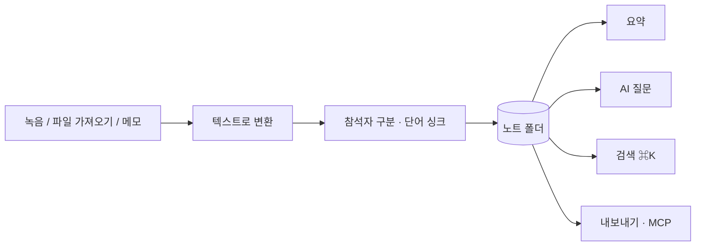
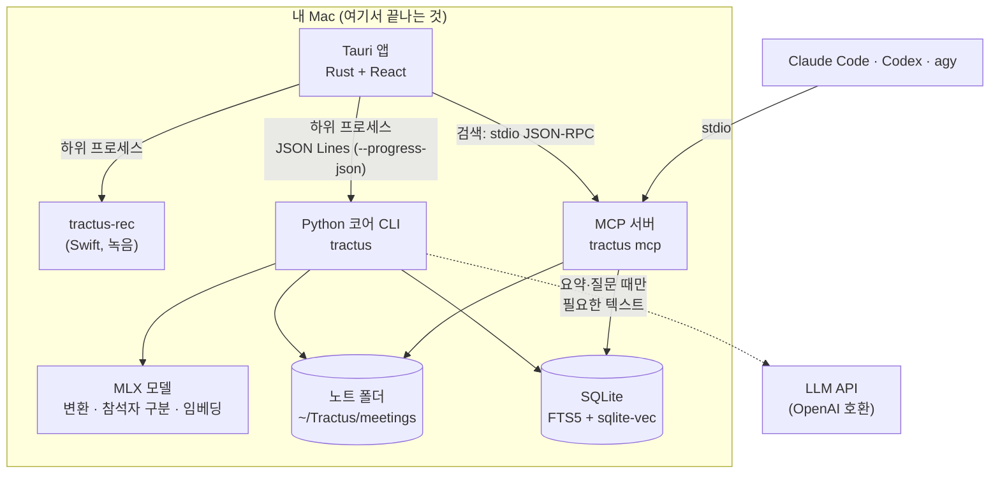

<a id="readme-top"></a>

<!-- PROJECT SHIELDS: 정적 배지만 쓴다. CI·커버리지·버전 배지는 해당 기능이 생기면 추가한다 -->
[![License][license-shield]][license-url]
[![macOS][macos-shield]][setup-url]
[![Python][python-shield]][python-url]
[![Tauri][tauri-shield]][tauri-url]
[![Local-first][local-shield]][arch-url]
[![Status][status-shield]][roadmap-url]

<br />
<div align="center">
  <h1 align="center">Tractus</h1>

  <p align="center">
    녹음과 메모를 <b>내 Mac 안에서</b> 텍스트로 바꾸고, 요약·검색·AI 질문까지 하는 로컬 우선 노트 도구
    <br />
    <a href="docs/setup.md"><strong>설치 안내 »</strong></a>
    <br />
    <br />
    <a href="docs/setup.md">설치</a>
    &middot;
    <a href="docs/desktop.md">문서</a>
    &middot;
    <a href="docs/roadmap.md">로드맵</a>
    &middot;
    <a href="https://github.com/sjoon21/Tractus/issues">이슈</a>
  </p>
</div>

<!-- TABLE OF CONTENTS -->
<details>
  <summary>목차</summary>
  <ol>
    <li><a href="#프로젝트-소개">프로젝트 소개</a> (<a href="#주요-기능">주요 기능</a>, <a href="#만든-기술">만든 기술</a>, <a href="#스크린샷">스크린샷</a>)</li>
    <li><a href="#시작하기">시작하기</a> (<a href="#요구-사항">요구 사항</a>, <a href="#빠른-설치">빠른 설치</a>, <a href="#처음-실행과-시작-점검">시작 점검</a>, <a href="#모델-받기">모델 받기</a>, <a href="#ai-키-등록">AI 키</a>)</li>
    <li><a href="#사용법">사용법</a> (<a href="#앱에서">앱에서</a>, <a href="#단축키">단축키</a>, <a href="#cli-빠른-참조">CLI</a>)</li>
    <li><a href="#claude-codecodexantigravity-연동-mcp">Claude Code·Codex·Antigravity 연동 (MCP)</a></li>
    <li><a href="#구성">구성</a></li>
    <li><a href="#모델과-라이선스">모델과 라이선스</a></li>
    <li><a href="#로드맵">로드맵</a></li>
    <li><a href="#개발">개발</a></li>
    <li><a href="#라이선스">라이선스</a></li>
    <li><a href="#감사의-말">감사의 말</a></li>
    <li><a href="#문의">문의</a></li>
  </ol>
</details>

<!-- ABOUT THE PROJECT -->
## 프로젝트 소개

Tractus는 노트와 녹음을 한곳에서 다루는 macOS 앱입니다. 소리를 녹음하거나 파일을 가져오면 **이 Mac 안에서** 텍스트로 바꾸고, 글로 쓴 메모도 같은 노트로 다룹니다. 요약, 검색, AI 질문은 모든 노트에 똑같이 됩니다.

- **오디오는 이 Mac을 떠나지 않습니다.** 텍스트 변환, 참석자 구분, 저장, 검색도 모두 로컬에서 돌아갑니다.
- **LLM만 API로 부릅니다.** 요약과 AI 질문을 요청할 때만, 필요한 텍스트(노트 제목, 참석자 이름, 대화 내용, 메모)를 OpenAI 호환 API로 보냅니다. 원격 전송을 막으려면 `TRACTUS_LOCAL_ONLY=1`입니다 ([무엇이 나가는가](#무엇이-이-mac에-남고-무엇이-나가는가)).
- **파일이 원본입니다.** 노트는 `~/Tractus/meetings/` 아래의 폴더(오디오, JSON, Markdown, 자막)라서 Obsidian 같은 도구로도 열립니다. 검색용 정보(색인)는 지워도 노트에서 다시 만들어집니다.
- **에이전트가 읽을 수 있습니다.** MCP 서버로 Claude Code, Codex, Antigravity가 내 노트를 검색하고 근거와 함께 인용합니다.

> **상태: 팀 내 시험 단계(베타).** 저장소를 내려받아 직접 빌드해 쓰는 개발자용 배포입니다. 저장소를 공개하기 전에는 아래 GitHub 링크(클론, 이슈)가 권한 있는 사람에게만 열립니다. 서명·공증을 받은 설치 파일은 없습니다. 알려진 한계는 [로드맵](#로드맵)에 있습니다.

<p align="right">(<a href="#readme-top">맨 위로</a>)</p>

### 주요 기능

| 영역 | 할 수 있는 일 |
| --- | --- |
| 녹음 | 마이크(대면)와 시스템 소리(화상 통화)를 함께 녹음합니다. 녹음 중에 메모와 북마크를 남기고, 실시간 텍스트 변환(미리보기)을 켤 수 있습니다. 미리보기는 메모리 16GB 이상과 가벼운 변환 엔진(`asr-lite`)이 필요합니다. 표준 엔진으로도 재 봤지만 글자가 확정되기까지 p95로 약 1.6~2초(부하가 있는 Mac에서 잰 값, 중간값도 약 1초 이상)라 기준 1초를 넘어 쓰지 않습니다 |
| 메뉴 막대 | 메뉴 막대 아이콘에서 창을 열지 않고 녹음을 시작·종료하고 북마크를 남기며 최근 노트를 엽니다. 녹음 중에는 경과 시간이 보이고, 창을 닫아도 앱이 메뉴 막대에 남아 녹음과 변환이 이어집니다(설정에서 끌 수 있습니다) |
| 가져오기 | m4a, mp3, wav 같은 오디오와 mp4, mov 같은 동영상을 끌어 놓으면 텍스트로 바꿉니다. 같은 파일은 다시 변환하지 않습니다 |
| 텍스트 변환 | Qwen3-ASR(MLX)로 한국어·영어를 자동 감지해 변환합니다. 중간에 멈춰도 이어서 합니다 |
| 참석자 | 목소리로 말하는 사람을 나눕니다(기본 8명, 9명 이상은 보조 도구). 이름을 붙이고 합치며, 목소리를 등록하면 다음 녹음부터 이름을 **제안**합니다 |
| 단어 싱크 | 단어마다 재생 시각을 맞춰 재생 중인 단어를 강조하고, 단어를 누르면 그 자리부터 재생합니다 |
| 수정 | 대화 내용을 고치고 찾아 바꿉니다. 고친 말은 `자주 쓰는 단어`에 넣어 다음 변환부터 더 정확하게 인식시킵니다 |
| 메모 | 오디오 없이 글만 쓰는 메모 노트, 녹음 노트의 `메모` 탭, 글만 있는 노트에 녹음 추가 |
| 요약 | 결정 사항과 할 일을 근거 대화와 함께 정리합니다. 요약 유형 6가지와 직접 쓴 요약 방법을 지원하고 한 노트에 여러 요약을 둡니다 |
| AI 질문 | 한 노트 또는 모든 노트에 질문하면 근거 대화를 붙여 답하게 합니다. 근거와 맞지 않는 인용은 지우고, 근거가 없으면 `근거 대화 없음`으로 표시합니다 |
| 검색 | 단어 일치와 비슷한 뜻을 함께 찾습니다 (⌘K) |
| 정리 | 즐겨찾기, 태그, 폴더(3단계), 목록 순서 |
| 내보내기 | txt, md, srt, vtt, csv, docx, 전체 백업(ZIP), PDF 인쇄 |
| 에이전트 연동 | MCP 서버 도구 7개 |

<p align="right">(<a href="#readme-top">맨 위로</a>)</p>

### 만든 기술

- [![Python][python-badge]][python-url] 코어 CLI `tractus` (Typer)
- [![MLX][mlx-badge]][mlx-url] 변환·참석자 구분·임베딩 (mlx-audio, mlx-lm)
- [![Tauri][tauri-badge]][tauri-url] 데스크톱 앱 (Rust + React 19 + TypeScript + Vite)
- [![Swift][swift-badge]][swift-url] 녹음 프로그램 `tractus-rec` (Core Audio process tap)
- [![SQLite][sqlite-badge]][sqlite-url] 검색 색인 (FTS5 음절 bigram + sqlite-vec)
- [![MCP][mcp-badge]][mcp-url] 에이전트 연동 서버

<p align="right">(<a href="#readme-top">맨 위로</a>)</p>

### 스크린샷

<!-- 스크린샷은 앱 화면을 캡처해 docs/images/ 에 넣고 여기에 추가한다. 아직 없다. -->

스크린샷은 준비 중입니다. 그동안 흐름과 주요 화면을 글로 설명합니다.



- **사이드바:** `새 노트` 메뉴(글쓰기, 녹음 시작, 파일 가져오기), 노트 검색, 즐겨찾기·폴더·태그로 거른 노트 목록, `AI 어시스턴트에게 질문`, `모델`, 설정
- **노트 화면:** 위에 플레이어, 가운데에 시각과 참석자가 붙은 대화 내용, 오른쪽 패널에 `요약` · `AI 질문` · `메모` 탭. **모델 화면과 시작 점검**은 모델의 크기·설치 상태와 못 쓰는 기능의 고치는 방법을 보여 줍니다

<p align="right">(<a href="#readme-top">맨 위로</a>)</p>

<!-- GETTING STARTED -->
## 시작하기

저장소를 내려받아 내 Mac에서 직접 빌드합니다. 자세한 순서와 문제 해결은 [docs/setup.md](docs/setup.md)에 있습니다.

### 요구 사항

| 항목 | 최소 | 권장 |
| --- | --- | --- |
| 칩 | Apple Silicon (M1 이상) | M1 Pro 이상 |
| macOS | 14.4 | 최신 버전 |
| 메모리 | 8GB (저사양 구성) | 16GB 이상 (표준 구성) |
| 디스크 여유 | 15GB (빌드 산출물 약 2.5GB(추정) + 모델 최대 6.2GB) | 25GB |

- Intel Mac은 지원하지 않습니다. 변환 모델이 MLX(Apple Silicon 전용)로 돌아갑니다.
- **최소 사양은 설계 기준이고 직접 돌려 보지는 못했습니다.** 8GB는 메모리 사용량 계산으로, macOS 14.4는 시스템 오디오 녹음(Core Audio process tap)의 하한으로 정했습니다. 개발 기기는 Apple M3, 16GB, macOS 26.6입니다.
- 도구: Xcode 명령줄 도구(Swift 5.10 이상, Xcode 15.3. 개발 기기의 Swift 6.4·Xcode 27에서만 빌드를 확인했습니다), Rust, Node.js 22.12 이상, pnpm, uv(Python은 uv가 받습니다), ffmpeg. `scripts/bootstrap.sh`가 Xcode 도구와 Homebrew를 제외한 나머지를 [Brewfile](Brewfile)로 설치합니다.
- ffmpeg는 앱에 넣지 않았습니다. 없어도 녹음은 되지만 텍스트 변환과 파일 가져오기는 안 됩니다.
- 9명 이상 참석자 구분 도우미(`--with-fluid`)는 Swift 6.2 이상(Xcode 26)이 필요합니다. 없어도 8명까지는 구분합니다.

### 빠른 설치

```bash
git clone https://github.com/sjoon21/Tractus.git && cd Tractus
scripts/bootstrap.sh      # 빠진 개발 도구를 Homebrew로 설치합니다 (설치 전에 묻습니다)
scripts/install.sh        # 코어 + 녹음 프로그램 + 앱을 빌드합니다
```

- 아무것도 바꾸지 않고 확인만 하려면 `scripts/bootstrap.sh --check`, `scripts/install.sh --check`입니다. `bootstrap.sh`는 `--yes`(묻지 않음), `--with-install`(이어서 `install.sh` 실행)도 받습니다.
- Xcode 명령줄 도구(`xcode-select --install`)와 Homebrew는 스크립트가 대신 설치하지 않고 안내만 합니다. `sudo`도 쓰지 않습니다.
- `install.sh` 옵션: `--with-fluid`(9명 이상 참석자 구분 도우미 빌드), `--models <required|standard|lite|all>`(끝에 모델 받기), `--copy-app`(`~/Applications`에 복사).
- 처음 Rust를 컴파일하므로 빌드에 15~30분쯤 걸릴 것으로 예상합니다(추정치). 여러 번 실행해도 안전합니다.
- **설치한 뒤에는 저장소 폴더를 옮기거나 지우지 마세요.** 앱이 이 폴더 안의 `tractus`와 `tractus-rec`를 실행합니다.

터미널 CLI만 쓸 때는 코어만 설치해도 됩니다.

```bash
uv sync                  # .venv/bin/tractus
cp .env.example .env     # 선택: 개발 기본값(경로, LLM 공급자). API 키는 .env.local에 둡니다
```

### 처음 실행과 시작 점검

```bash
open app/src-tauri/target/release/bundle/macos/Tractus.app    # --copy-app을 썼다면 ~/Applications/Tractus.app
```

처음 열면 **시작 점검**이 나옵니다. 시스템(Apple Silicon, macOS, 메모리, 디스크), 도구(ffmpeg, 녹음 프로그램), 모델, 권한 안내, AI 키를 항목별로 점검하고 막힌 항목에는 고치는 방법을 보여 줍니다. 점검은 앱 사용을 막지 않습니다. 터미널에서는 `uv run tractus doctor`입니다.

직접 빌드한 앱은 공증을 받지 않아 "확인되지 않은 개발자" 경고가 나올 수 있습니다. macOS 14 이하에서는 Finder에서 우클릭 후 `열기`를, macOS 15 이상에서는 시스템 설정 › 개인정보 보호 및 보안 › `그래도 열기`를 고릅니다(자세한 방법은 [docs/setup.md](docs/setup.md#확인되지-않은-개발자-경고)). 마이크와 시스템 오디오 권한은 첫 녹음 때 macOS가 묻습니다.

### 모델 받기

모델 파일은 저장소에 들어 있지 않습니다. 앱은 왼쪽 아래 `모델` 화면(또는 시작 점검)에서, 터미널은 다음 명령으로 받습니다. 받는 위치는 기본 `~/Tractus/models`이고 `TRACTUS_MODELS_DIR`로 바꿉니다(`.env.example`을 복사하면 `./models`로 바뀝니다). 받다 끊겨도 같은 명령으로 이어 받습니다. 목록의 원본은 `src/tractus/models_registry.py`입니다.

```bash
uv run tractus models list                          # 설치 상태
uv run tractus models download --preset standard    # required | standard | lite | all, 또는 모델 ID
uv run tractus models remove aligner                # 하나 지우기
```

구성은 `standard`(약 5.2GB, 메모리 16GB 이상), `lite`(약 1.2GB, 메모리 8GB), `required`(1.0~2.5GB, 변환에 꼭 필요한 것만), `all`(약 6.2GB)입니다. 기본 흐름(녹음·가져오기 → 변환 → 요약)은 `required`로 됩니다. 실시간 텍스트 변환(미리보기)은 메모리 16GB 이상에서만 켜지고 가벼운 엔진(`asr-lite`)이 따로 필요하므로, 8GB Mac(`lite` 구성)에서는 쓸 수 없습니다. 변환 엔진 둘(`asr-std`·`asr-lite`)은 **필수 (둘 중 하나)** 입니다: 하나만 받아도 텍스트 변환이 되고, 모델 화면에는 `변환 엔진: 설치됨`으로 보입니다.

모델이 없는 기능은 단추를 눌러 보면 이유와 설치 방법을 알려 줍니다. 녹음은 모델 없이 되고, 변환 엔진이 없으면 `변환 대기 중인 녹음`으로 남습니다.

### AI 키 등록

요약과 AI 질문은 LLM API가 필요합니다. 키가 없어도 녹음, 변환, 검색, 내보내기는 모두 됩니다.

- **앱:** 설정 › `AI 요약·질문`에서 Upstage API 키를 붙여 넣습니다. 키는 앱 설정 폴더(`~/Library/Application Support/dev.tractus.app/`)에만 저장되고 노트 폴더에는 쓰지 않습니다.
- **터미널:** 저장소 루트의 `.env.local`(git 제외)에 넣습니다. 우선순위는 셸 환경변수 > `.env.local` > `.env`입니다.

```bash
# .env.local
UPSTAGE_API_KEY=up_...
```

#### 요약·결정 사항·할 일

공급자는 OpenAI 호환 API 키 방식만 씁니다. `TRACTUS_LLM_PROVIDER`나 `--provider`로 고릅니다.

| 공급자 | 키 | 기본 모델 | 상태 |
| --- | --- | --- | --- |
| `upstage` | `UPSTAGE_API_KEY` | `solar-pro4` | 검증됨 |
| `openai` | `OPENAI_API_KEY` | 없음 (`--model` 필요) | 키 대기 |
| `claude` | `ANTHROPIC_API_KEY` | `claude-sonnet-5-5` | 키 대기 |
| `gemini` | `GEMINI_API_KEY` | 없음 (`--model` 필요) | 키 대기 |
| `gemma-local` | 없음 (`localhost:11434`) | `gemma4:31b` | 로컬 서버 필요 |

앱에서 키를 등록할 수 있는 서비스는 지금 Upstage뿐입니다. `TRACTUS_LOCAL_ONLY=1`이면 원격 공급자를 막습니다. 구독형 CLI(`claude -p`, `codex exec`, `agy`)는 약관 문제로 공급자로 쓰지 않습니다(ARCHITECTURE.md §0).

<p align="right">(<a href="#readme-top">맨 위로</a>)</p>

<!-- USAGE EXAMPLES -->
## 사용법

### 앱에서

<details open>
<summary><b>노트 만들기</b></summary>

- **녹음:** `새 노트` › `녹음 시작`. 녹음 방식은 `대면 녹음`과 `화상·하이브리드`(시스템 소리 포함) 중에서 고릅니다. 녹음 중에 메모를 쓰거나 `B`로 북마크를 남기고, `녹음 종료 및 변환`을 누르면 이 Mac에서 텍스트로 바꿉니다.
- **파일 가져오기:** `새 노트` › `파일 가져오기`, 또는 창에 파일을 끌어 놓습니다. 오디오와 동영상을 받습니다. 여러 파일은 차례로 변환합니다.
- **메모 쓰기:** `새 노트` › `글쓰기`(⌘N). 쓰는 대로 저장됩니다. 메모도 같은 노트라서 요약, AI 질문, 검색, 내보내기가 됩니다. 위치는 시각 대신 `3번째 줄`로 가리킵니다.
- **글만 있는 노트에 녹음 붙이기:** 메모 머리의 `녹음 추가` 또는 `파일에서 추가`. 노트가 녹음 노트로 바뀌고 쓴 글은 `메모` 탭으로 옮겨집니다.
- **녹음 노트에 메모 적기:** 오른쪽 패널의 `메모` 탭. 메모는 검색, AI 질문, 요약의 근거가 됩니다.

</details>

<details>
<summary><b>다듬기: 참석자, 대화 내용, 단어 싱크</b></summary>

- 참석자 막대에서 이름을 두 번 눌러 바꾸고, 다른 참석자에 끌어 놓아 `동일 인물로 합치기`를 합니다. 이름 바꿀 때 `이 참석자 목소리 등록`을 고르면 다음 녹음부터 `{이름} 님인가요?`라고 제안합니다. 목소리는 생체정보라서 본인이거나 동의를 받은 사람만 등록하세요.
- 대화를 두 번 누르거나 Enter로 내용을 고칩니다(Enter 저장, Esc 취소). 원문은 `수정 전`으로 남습니다. ⌘F로 찾아 바꿉니다.
- `단어 싱크 맞추기`를 누르면 재생 중인 단어가 강조되고 단어를 눌러 그 자리부터 들을 수 있습니다. 새 녹음은 자동으로 맞춥니다.
- 플레이어: 배속 0.8~2배, `이 참석자만 듣기`, `침묵 구간 건너뛰기`, `목소리 선명하게`.

</details>

<details>
<summary><b>요약과 AI 질문</b></summary>

- **요약:** 오른쪽 `요약` 탭. 기본은 `회의록`(요약, 결정 사항, 할 일)이고, `요약 유형` 메뉴에서 핵심 요약, 할 일 중심, 강의·세미나, 인터뷰·면담, 아이디어 정리를 고릅니다(여러 개를 한 번에 만들 수 있습니다). `직접 프롬프트로 요약…`으로 내 요약 방법을 쓰고 `내 유형`으로 저장합니다(설정 › `요약 템플릿`). 모든 항목에 근거 대화의 시각이 붙고, 누르면 그 자리로 이동합니다.
- **AI 질문:** 오른쪽 `AI 질문`은 이 노트 내용으로, ⌘J(`AI 어시스턴트에게 질문`)는 모든 노트에서 찾아 답합니다. 답 속 시각을 누르면 근거 대화로 이동하고, 근거가 없으면 `근거 대화 없음`으로 알려 줍니다. 보내기 전에 어느 AI 서비스로 무엇이 전송되는지 안내합니다.

</details>

<details>
<summary><b>찾기, 정리, 내보내기, 삭제</b></summary>

- **검색:** ⌘K. 단어 일치와 `비슷한 뜻`을 함께 보여 줍니다. 스마트 검색 모델이 없으면 단어 일치로만 찾습니다.
- **정리:** 노트 머리에서 즐겨찾기(★), 태그(20개까지), 폴더(3단계까지)를 붙입니다. 사이드바에서 폴더로 끌어 놓을 수 있고, 목록은 `최근 수정 순`·`만든 순`·`제목 순`·`길이 순`으로 봅니다.
- **내보내기:** txt, md, srt, vtt, csv(한국어 Excel에서 바로 열림), docx, 전체 백업(ZIP: 오디오 + 대화 내용 + 요약 + 메모), PDF(인쇄). 참석자 이름과 고친 내용이 반영됩니다. 메모 노트는 srt·vtt로 내보낼 수 없습니다.
- **삭제:** 노트 머리의 `삭제`는 폴더를 macOS 휴지통으로 옮깁니다. 영구 삭제는 없습니다.

</details>

### 단축키

| 키 | 동작 |
| --- | --- |
| ⌘N | 글쓰기 (새 메모) |
| ⌘K | 노트 검색 |
| ⌘J | AI 어시스턴트에게 질문 (모든 노트) |
| ⌘F | 대화 내용에서 찾아 바꾸기 |
| ⌘Z | 대화 내용 수정 되돌리기 |
| ⌘S | 메모 바로 저장 (평소에도 자동 저장) |
| Space | 재생 / 일시정지 |
| ← → | 5초 이동 (Shift와 함께 10초) |
| Shift + , / Shift + . | 배속 내리기 / 올리기 |
| B | 녹음 중 북마크 |

### CLI 빠른 참조

앱 없이 터미널만으로도 변환, 요약, 질문, 검색, 내보내기를 할 수 있습니다. 노트는 `meeting_id`의 앞부분만 써도 찾습니다(아래 `01K6X3`). 전체 옵션은 `uv run tractus <명령> --help`입니다.

```bash
uv run tractus transcribe 주간회의.m4a --title "3분기 예산 회의" -t 김철수 -t "Project Atlas"
uv run tractus transcribe 회의.m4a --append-to 01K6X3     # 글만 있는 노트에 녹음 추가
uv run tractus doctor                                      # 시스템·도구·모델·기능 점검 (--json)
uv run tractus models list                                 # 모델 설치 상태 (download · remove)
uv run tractus summarize 01K6X3                            # 회의록 요약
uv run tractus summarize 01K6X3 --template brief           # todo | lecture | interview | ideas, templates list로 확인
echo "GPU 서버 구매는 어떻게 하기로 했어?" | uv run tractus ask --meeting 01K6X3
uv run tractus search "GPU 서버 구매" --from 2026-07-01 --to 2026-09-30
uv run tractus export 01K6X3 --format docx --out 주간회의.docx   # txt | md | srt | vtt | csv | docx | bundle
uv run tractus note new --title "장보기"                   # 메모 노트 (save · title · meta)
uv run tractus render --all                                # transcript.md·vtt를 다시 만듭니다
```

<details>
<summary><b>더 보기: 변환 옵션, 참석자, 목소리, 정리 명령</b></summary>

| `transcribe` 옵션 | 설명 |
| --- | --- |
| `--track standard\|lite` | 생략하면 메모리 16GB 이상이면 `standard`(1.7B), 아니면 `lite`(0.6B) |
| `--language auto\|ko\|en` | 기본 `auto`. `ko`로 고정하면 영어 위주 말을 번역할 수 있어 권장하지 않습니다 |
| `-t`, `--term` | 이 노트의 용어(참석자 이름, 제품명). 여러 번 지정할 수 있습니다 |
| `--recording <폴더>` | `tractus-rec` 녹음 폴더를 변환(마이크·시스템 트랙을 섞음). `--keep-tracks`면 원본 트랙을 보관 |
| `--no-diarize`, `--max-speakers N` | 참석자 구분을 끄거나 상한을 둡니다 |
| `--diarizer auto\|nemotron\|fluid` | 기본 `auto`: Nemotron으로 나누고 8명을 모두 쓰면 `tractus-diar`로 다시 나눕니다 |
| `--no-align` | 단어 싱크를 만들지 않습니다 (나중에 `tractus align <노트>`) |

```bash
uv run tractus speakers 01K6X3 list                  # rename S1 "김민수" | set s0012 S2 | merge S3 S1 | dismiss S2
uv run tractus voices enroll 01K6X3 S1 --name "홍길동" --consent   # 목소리 등록 (list · match · forget)
echo '{"edits":[{"id":"s0012","text":"새 문장"}]}' | uv run tractus segments 01K6X3 edit
uv run tractus glossary add 쿠버네티스 "Project Atlas"   # 자주 쓰는 단어: ~/Tractus/glossary.md
echo '{"favorite": true, "tags": ["회의", "Q3"]}' | uv run tractus note meta 01K6X3
uv run tractus folders create --name 업무                # list | rename | move | delete
uv run tractus notes list --tag Q3 --sort title --order asc --json
uv run tractus search 예산 --tag Q3 --folder 업무
uv run tractus index --rebuild                            # 검색 색인을 처음부터 다시
echo '{"prompt": "결정은 번호를 붙여 정리해줘", "save_as": "결정"}' | uv run tractus summarize 01K6X3 --custom
uv run tractus live --recording ~/Tractus/recordings/01K… --progress-json   # 녹음 중 미리보기 (저장하지 않음)
```

- 이어하기: 중간에 멈춰도 같은 `transcribe` 명령을 다시 실행하면 끝난 청크 다음부터 이어갑니다.
- 목소리 등록에는 `--consent`가 필요합니다. 등록한 목소리는 `~/Tractus/voices.json`(권한 0600)에만 저장되고 Mac 밖으로 나가지 않습니다.
- `S1`·`S2` 같은 라벨은 CLI·JSON·MCP에서 그대로 쓰고, 앱과 내보낸 문서에서는 `참석자 1`로 보입니다.
- 노트 한 건의 폴더 구조는 [ARCHITECTURE.md](ARCHITECTURE.md) §4.1, JSON 스키마는 §6, 앱과 코어의 계약은 [docs/desktop.md](docs/desktop.md)에 있습니다.

</details>

<p align="right">(<a href="#readme-top">맨 위로</a>)</p>

<!-- MCP -->
## Claude Code·Codex·Antigravity 연동 (MCP)

에이전트 CLI가 Tractus를 도구로 써서 과거 노트를 검색합니다. 근거를 `[meeting_id#s0012 00:05:31]` 형식으로 인용하고, 요약을 직접 써서 저장할 수도 있습니다. **MCP 서버는 LLM을 호출하지 않습니다.** 추론은 각 CLI가 자기 구독·키로 합니다.

먼저 한 번 색인합니다(벡터는 CLI 쪽에서 만듭니다): `uv run tractus index`

아래 예시의 `/path/to/Tractus`는 이 저장소 경로입니다. `.venv/bin/tractus`는 `uv sync`(또는 `scripts/install.sh`) 뒤에 생깁니다. `TRACTUS_MODELS_DIR`은 모델을 받은 폴더(기본 `~/Tractus/models`)입니다.

**Claude Code** — 이름을 `-e`보다 앞에 둡니다.

```bash
claude mcp add -s user tractus -e TRACTUS_HOME=$HOME/Tractus -e TRACTUS_MODELS_DIR=$HOME/Tractus/models \
  -- /path/to/Tractus/.venv/bin/tractus mcp
```

**Codex CLI** — Codex는 셸 환경변수를 MCP 서버에 넘기지 않으므로 `env`를 꼭 적습니다. `~/.codex/config.toml`:

```toml
[mcp_servers.tractus]
command = "/path/to/Tractus/.venv/bin/tractus"
args = ["mcp"]
env = { TRACTUS_HOME = "/Users/me/Tractus", TRACTUS_MODELS_DIR = "/Users/me/Tractus/models" }
# 읽기 도구는 자동 승인됩니다. 요약 저장(save_summary)까지 묻지 않고 쓰려면 다음 줄을 추가합니다.
# tools.save_summary.approval_mode = "approve"
```

**Antigravity CLI (agy)**

```bash
agy mcp add --env TRACTUS_HOME=$HOME/Tractus --env TRACTUS_MODELS_DIR=$HOME/Tractus/models \
  tractus /path/to/Tractus/.venv/bin/tractus mcp
```

헤드리스(`agy -p`)에서 쓰려면 `~/.gemini/antigravity-cli/settings.json`의 `permissions.allow`에 `"mcp(tractus/*)"`를 추가합니다. 워크스페이스 설정은 무시됩니다. Gemini CLI는 개인 계정 지원이 끝나 대상에서 뺐습니다.

| 도구 | 기능 |
| --- | --- |
| `status` | 데이터 위치, 색인 상태 (결과가 비어 보이면 먼저 확인) |
| `search_meetings` | 하이브리드 검색, 날짜·노트·태그·폴더 필터, 세그먼트별 인용 표기 |
| `list_meetings` | 기간별 노트 목록 |
| `get_transcript` | 전사 본문, 고친 내용 반영 (페이지 단위) |
| `get_summary` / `list_action_items` | 요약(`template`으로 유형 지정), 할 일(기본 요약만) |
| `save_summary` | 에이전트가 쓴 요약을 검증해서 저장 (유일한 쓰기 도구) |

예: `claude -p "지난 분기 GPU 서버 구매 결정이 어떻게 바뀌었는지 내 노트에서 찾아서 근거와 함께 알려줘"`

AI Hub 같은 재배포 금지 데이터의 전사가 들어 있는 홈은 MCP에 연결하지 마세요. 에이전트가 읽는 내용은 각 CLI의 서비스로 전달됩니다.

<p align="right">(<a href="#readme-top">맨 위로</a>)</p>

<!-- ARCHITECTURE -->
## 구성



앱은 Rust가 하위 프로세스로 코어(`tractus`)와 녹음 프로그램(`tractus-rec`)을 띄우고, stdout의 JSON 이벤트를 화면에 전달합니다. 9명 이상 참석자 구분 도우미 `tractus-diar`는 `recorder/diar/`의 별도 Swift 패키지입니다([recorder/README.md](recorder/README.md)). 설계 결정의 원본은 [ARCHITECTURE.md](ARCHITECTURE.md)입니다.

### 무엇이 이 Mac에 남고, 무엇이 나가는가

| 데이터 | 처리 위치 | 외부로 나가는가 |
| --- | --- | --- |
| 오디오 | 녹음, 변환, 참석자 구분, 단어 싱크 모두 이 Mac | 나가지 않습니다 |
| 대화 내용, 노트, 메모 | `~/Tractus/meetings/` | 요약·질문 요청 때만 일부 (아래) |
| 검색 색인, 임베딩 | 이 Mac의 SQLite | 나가지 않습니다 |
| 참석자 목소리 프로필 | `~/Tractus/voices.json` (0600) | 나가지 않습니다. 검색·요약·AI 질문에도 쓰지 않습니다 |
| 요약 요청 | 선택한 LLM 서비스 | 노트 제목, 참석자 이름, 대화 내용(메모 포함), 요약 지침 |
| AI 질문 요청 | 선택한 LLM 서비스 | 질문, 최근 대화 6개 메시지, 근거 대화. 노트 범위는 그 노트 전체(10만 자가 넘으면 검색된 부분), 전체 범위는 검색 상위 8개와 앞뒤 대화. 검색 결과가 없으면 LLM을 부르지 않습니다 |
| 모델·도구 받기 | Hugging Face 등 | 받을 때만 인터넷을 씁니다 |

- API 키는 앱 설정 폴더(0600) 또는 `.env.local`에만 둡니다. 로그, 커밋, 노트 폴더에는 남기지 않습니다.
- `TRACTUS_LOCAL_ONLY=1`이면 원격 LLM을 막고 `gemma-local`만 허용합니다.

<p align="right">(<a href="#readme-top">맨 위로</a>)</p>

<!-- MODELS AND LICENSES -->
## 모델과 라이선스

Tractus는 모델 가중치를 저장소에 넣지 않습니다. 사용자가 받으며, 모델마다 라이선스가 다릅니다. 앱의 `모델` 화면에 이름, 만든 곳, 라이선스가 있고, 고지 전문은 [NOTICE](NOTICE)에 있습니다.

| 모델 | 역할 | 크기 | 라이선스 |
| --- | --- | --- | --- |
| [Qwen3-ASR 1.7B (MLX 8bit)](https://huggingface.co/mlx-community/Qwen3-ASR-1.7B-8bit) | 텍스트 변환, 표준 | 2.5GB | Apache-2.0 |
| [Qwen3-ASR 0.6B (MLX 8bit)](https://huggingface.co/mlx-community/Qwen3-ASR-0.6B-8bit) | 텍스트 변환, 저사양·실시간 미리보기 | 1.0GB | Apache-2.0 |
| [Silero VAD v6 (MLX)](https://huggingface.co/mlx-community/silero-vad-v6) | 무음 기준 청크 분할 | 1MB | MIT |
| [Nemotron 3 Diarization (MLX)](https://huggingface.co/mlx-community/Nemotron-3-Diarization) | 참석자 구분 (최대 8명) | 0.2GB | [OpenMDW-1.1](https://openmdw.ai/license/1-1/) |
| [FluidInference/speaker-diarization-coreml](https://huggingface.co/FluidInference/speaker-diarization-coreml) | 9명 이상 참석자 구분 (pyannote community-1의 Core ML 변환) | 22MB + 도우미 | [CC-BY-4.0](https://creativecommons.org/licenses/by/4.0/) (출처 표기 필요) |
| [Qwen3-ForcedAligner 0.6B (MLX 8bit)](https://huggingface.co/mlx-community/Qwen3-ForcedAligner-0.6B-8bit) | 단어 싱크 | 1.3GB | Apache-2.0 |
| [Qwen3-Embedding 0.6B](https://huggingface.co/Qwen/Qwen3-Embedding-0.6B) | 스마트 검색 (비슷한 뜻) | 1.2GB | Apache-2.0 |
| [3D-Speaker CAM++ zh_en](https://modelscope.cn/models/iic/speech_campplus_sv_zh_en_16k-common_advanced) ([ONNX 변환](https://github.com/k2-fsa/sherpa-onnx/releases/tag/speaker-recongition-models)) | 참석자 목소리 프로필 | 28MB | Apache-2.0 |

변환 엔진 둘(1.7B·0.6B)은 **필수 (둘 중 하나)** 입니다. 하나만 있어도 텍스트 변환이 됩니다. 1.7B는 가장 정확하고 메모리 16GB 이상을 권하며, 0.6B는 메모리를 덜 쓰고 실시간 미리보기에는 0.6B가 따로 필요합니다.

Tractus 자체는 Apache-2.0입니다. 모델의 라이선스와 약관은 각각 따로 확인하세요. 크기와 리비전의 원본은 `src/tractus/models_registry.py`입니다.

<details>
<summary><b>모델을 고른 근거 (Phase 0 측정, 2026-10-02)</b></summary>

개발 기기(Apple M3, 16GB)에서 측정했습니다. 숫자는 낮을수록 좋습니다. 전체 표는 [bench/results/REPORT.md](bench/results/REPORT.md)에 있습니다.

| 모델 | 한국어 회의 CER | 한·영 혼용 MER | 영어 회의 WER | 1시간 회의 처리 시간 | 피크 메모리 |
| --- | --- | --- | --- | --- | --- |
| Qwen3-ASR-1.7B (표준) | 9.49% | 24.1 | 9.50% | 8.2분 | 3.6 GB |
| Qwen3-ASR-0.6B (저사양) | 11.47% | 26.1 | 10.14% | 3.3분 | 2.0 GB |
| Whisper-large-v3-turbo (대조군, 미채택) | 14.92% | 26.6 | 14.28% | 6.0분 | 2.2 GB |
| Nemotron 3.5 ASR 0.6B (참고, 미채택) | 10.93% | 45.1 | 14.13% | 7.6분 | 2.0 GB |

- CER·시간·메모리는 언어를 고정한 AI Hub 4개 세션, MER은 자동 감지 기준입니다. 메모리는 AI Hub 기준이고 [REPORT.md](bench/results/REPORT.md)의 최댓값은 0.6B가 2.37GB입니다.
- 언어는 자동 감지가 기본입니다. `Korean`으로 고정하면 영어 위주 말을 번역하거나 반복 루프에 빠졌습니다.
- 자주 쓰는 단어를 `hotwords`로 넣으면 용어 재현율이 72%에서 84%로 올랐습니다.
- 참석자 구분: AI Hub 7명 세션에서 7/7명, DER 7.6%(2026-10-04). 17명 세션은 Nemotron 혼동 28.5%에서 FluidAudio 6.9%로 줄었습니다(2026-10-07). 실제 대면 회의의 9명 이상은 재지 못했습니다.
- 벤치마크 재현: `cd bench && ./setup.sh && ./run_all.sh`. AI Hub 데이터는 재배포가 금지되어 저장소에 없습니다.

</details>

<p align="right">(<a href="#readme-top">맨 위로</a>)</p>

<!-- ROADMAP -->
## 로드맵

- [x] Phase 0: ASR 모델 선정 (Qwen3-ASR 1.7B·0.6B, 2026-10-02)
- [x] Phase 1: 텍스트 변환 CLI (VAD 청킹, 이어하기, 자주 쓰는 단어)
- [x] Phase 2: LLM 요약 (근거 대화 필수, 검증과 재요청)
- [x] Phase 3: 검색(키워드 + 의미)과 MCP 서버
- [x] Phase 4: Tauri 앱과 녹음 프로그램 (마이크 + 시스템 오디오)
- [x] Phase 5: 대화 내용 수정, 찾아 바꾸기, 파일 가져오기, 내보내기, 재생 컨트롤
- [x] Phase 6: 단어 싱크, AI 질문, PDF, 목소리 선명하게
- [x] Phase 7: 참석자 목소리 프로필, 실시간 텍스트 변환(미리보기), 9명 이상 참석자 구분
- [x] 메모 노트와 녹음 노트의 `메모` 탭, 글만 있는 노트에 녹음 추가 (v3.18~v3.19)
- [x] 즐겨찾기·태그·폴더·목록 순서, 요약 유형과 직접 프롬프트 (v3.20~v3.21)
- [x] 설정에서 AI 키 등록, 모델 받기와 시작 점검, 기능별 막기 (v3.22~v3.23)
- [x] 메뉴 막대 아이콘: 창 없이 녹음 시작·종료·북마크, 최근 노트, 창을 닫아도 남기기 (v3.24, 이슈 #1). 설정 `메뉴 막대에 Tractus 표시`·`창을 닫아도 메뉴 막대에 남기기`(둘 다 기본 켜짐, 바로 적용)
- [ ] 팬 없는 M3 Air에서 1시간 연속 녹음 + 실시간 텍스트 변환의 발열·지연 확인
- [ ] 실제 대면 회의(원거리 마이크)의 단어 싱크·목소리 인식 정확도, 9명 이상 참석자 구분 측정
- [ ] OpenAI·Claude·Gemini 공급자 검증 (지금은 키 대기, Upstage만 검증)
- [ ] 서명·공증을 받은 설치 파일 (지금은 직접 빌드)
- [ ] WKWebView에서 손으로 확인하지 못한 화면 점검 (노트 끌어 놓기, 요약 유형 메뉴). 단어 강조 등 WebKit 기능은 macOS 26.6에서만 확인했고 최소 버전 14.4에서는 확인하지 못했습니다
- [ ] 키를 Keychain에 저장 (지금은 앱 설정 폴더의 0600 파일)
- [ ] Windows 지원 (llama.cpp GGUF 경로, 필요가 확인될 때)

**알려진 한계:** 메모를 모두 지우고 새로 쓰면 줄 ID가 `m0001`부터 다시 시작해 옛 요약의 근거와 겹칠 수 있습니다. 녹음을 추가하는 동안의 AI 질문은 막지 않습니다. 여러 유형을 한 번에 만드는 요약은 중간에 취소할 수 없습니다. 목록은 [ARCHITECTURE.md](ARCHITECTURE.md) 변경 이력과 [docs/desktop.md](docs/desktop.md) 각 절의 `알려진 한계`가 원본입니다.

전체 계획과 근거는 [docs/roadmap.md](docs/roadmap.md)와 [ARCHITECTURE.md §8](ARCHITECTURE.md)에 있습니다. 제안할 기능과 알려진 문제는 [이슈](https://github.com/sjoon21/Tractus/issues)에 남겨 주세요.

<p align="right">(<a href="#readme-top">맨 위로</a>)</p>

<!-- CONTRIBUTING -->
## 개발

```text
ARCHITECTURE.md   설계 백본 (결정 사항, 변경 이력, 로드맵, Phase 0 결과)
CLAUDE.md         에이전트·기여자 작업 지침 (모델·파이프라인 기본값, 데이터 규칙)
WORDS.md          화면에 보이는 말의 용어표와 금지어 검사
src/tractus/      코어: CLI, 변환, 참석자 구분, 요약, 질문, 검색, MCP
app/              Tauri 2 데스크톱 앱 (Rust + React + TypeScript)
recorder/         Swift 패키지: 녹음 프로그램 tractus-rec (diar/: 도우미 tractus-diar)
scripts/          bootstrap.sh (개발 도구 설치), install.sh (빌드)
Brewfile          bootstrap.sh가 읽는 도구 목록
docs/             설치(setup), 앱 계약(desktop), 로드맵(roadmap), 공급자(llm-providers)
tests/            pytest (가상 회의 fixtures)
bench/            Phase 0 벤치마크와 평가 스크립트 (지표 요약과 리포트만 커밋)
```

```bash
uv run pytest                       # 단위·CLI 테스트 (모델·API 키 불필요)
uv run pytest -m slow               # 실제 모델 테스트 (models/ 필요)
uv run pytest -m llm                # 실제 LLM API 스모크 (키가 있는 공급자만)
uv run python bench/search_eval.py  # 검색 평가 (가상 회의)
uv run python bench/ask_eval.py     # AI 질문 평가 (가상 회의, 설정된 LLM 호출)
cd app && pnpm install && pnpm test && pnpm build   # 앱: vitest, tsc, vite
cd app/src-tauri && cargo test                      # 앱 Rust 테스트
(cd recorder && swift build -c release && swift test)       # 녹음 프로그램 (Swift 5.10 이상)
(cd recorder/diar && swift build -c release && swift test)  # 9명 이상 구분 도우미 (Swift 6.2 이상)
cd app && pnpm tauri dev                            # 개발 실행
```

화면에 보이는 문구를 바꿨다면 커밋 전에 [WORDS.md §5](WORDS.md)의 금지어 검사를 저장소 루트에서 돌립니다. 출력이 없으면 통과입니다(`rg`가 PCRE2를 지원해야 합니다).

### 기여하기

이슈와 풀 리퀘스트를 환영합니다. 큰 변경은 먼저 이슈로 의견을 나눠 주세요.

1. 저장소를 포크하고 브랜치를 만듭니다 (`git checkout -b feat/기능-이름`)
2. 변경과 테스트를 함께 작성하고 `uv run pytest`와 `cd app && pnpm test`를 통과시킵니다
3. 커밋 메시지는 `<type>: <설명>` 형식입니다. type은 `feat`, `fix`, `refactor`, `docs`, `test`, `chore`, `perf`, `ci` 중 하나로 영문 그대로 쓰고, 설명과 본문은 한국어로 씁니다
   ```text
   feat: 노트 제목 수정 추가
   ```
4. 브랜치를 올리고 풀 리퀘스트를 엽니다

기여 전에 알아 둘 규칙은 [CLAUDE.md](CLAUDE.md)에 있습니다.

- 설계 결정을 바꾸려면 [ARCHITECTURE.md](ARCHITECTURE.md)부터 고칩니다. 새 벤치마크 없이 ASR 모델을 바꾸거나 추가하지 않습니다.
- 사용자에게 보이는 말은 [WORDS.md](WORDS.md)를 따릅니다 (`노트`, `텍스트로 변환`, `참석자`).
- 표시 텍스트는 `store.seg_text(s)`로 읽습니다. 원문 `text`는 바꾸지 않습니다.
- `models/`, `data/`, `bench/results/raw/`, API 키는 커밋하지 않습니다. AI Hub 데이터와 그 전사는 재배포가 금지되어 있고, 원격 LLM에도 보내지 않습니다.
- copyleft 의존성(GPL, LGPL 등)을 넣지 않습니다.

<p align="right">(<a href="#readme-top">맨 위로</a>)</p>

<!-- LICENSE -->
## 라이선스

[Apache License 2.0](LICENSE)으로 배포합니다. 제3자 모델의 라이선스 고지는 [NOTICE](NOTICE)에 있고, 모델마다 라이선스가 다릅니다(위 [모델과 라이선스](#모델과-라이선스)).

<p align="right">(<a href="#readme-top">맨 위로</a>)</p>

<!-- ACKNOWLEDGMENTS -->
## 감사의 말

Tractus는 아래 오픈소스와 공개 모델 위에 만들었습니다. 라이선스 고지는 [NOTICE](NOTICE)에 있습니다.

- [Qwen3-ASR · Qwen3-ForcedAligner · Qwen3-Embedding](https://huggingface.co/Qwen) (Alibaba Qwen 팀): 변환, 단어 싱크, 스마트 검색
- [mlx-audio](https://github.com/Blaizzy/mlx-audio), [MLX](https://github.com/ml-explore/mlx), [mlx-lm](https://github.com/ml-explore/mlx-lm): Apple Silicon에서 모델 실행
- [Silero VAD](https://github.com/snakers4/silero-vad): 목소리 구간 감지
- [NVIDIA Nemotron 3 Diarization](https://huggingface.co/nvidia/Nemotron-3-Diarization): 참석자 구분
- [FluidAudio](https://github.com/FluidInference/FluidAudio), [pyannote community-1](https://huggingface.co/pyannote/speaker-diarization-community-1), [WeSpeaker](https://github.com/wenet-e2e/wespeaker): 9명 이상 참석자 구분
- [3D-Speaker CAM++](https://modelscope.cn/models/iic/speech_campplus_sv_zh_en_16k-common_advanced), [k2-fsa/sherpa-onnx](https://github.com/k2-fsa/sherpa-onnx)(ONNX 변환본), [onnxruntime](https://github.com/microsoft/onnxruntime), [kaldi-native-fbank](https://github.com/csukuangfj/kaldi-native-fbank): 참석자 목소리 프로필
- [SQLite](https://www.sqlite.org), [sqlite-vec](https://github.com/asg017/sqlite-vec): 검색 색인
- [Tauri](https://tauri.app), [React](https://react.dev), [Vite](https://vite.dev): 데스크톱 앱
- [python-docx](https://github.com/python-openxml/python-docx), [Typer](https://typer.tiangolo.com), [MCP Python SDK](https://github.com/modelcontextprotocol/python-sdk), [openai-python](https://github.com/openai/openai-python): 코어
- [Pretendard](https://github.com/orioncactus/pretendard): 앱 글꼴
- 벤치마크 데이터: [FLEURS](https://huggingface.co/datasets/google/fleurs), [HiKE](https://huggingface.co/datasets/thetaone-ai/HiKE), [AMI](https://huggingface.co/datasets/edinburghcstr/ami), [AI Hub 회의 음성](https://www.aihub.or.kr/aihubdata/data/view.do?dataSetSn=464)
- [docs/roadmap.md](docs/roadmap.md)에 설계를 참고한 프로젝트와 라이선스를 적어 두었습니다.
- [Best-README-Template](https://github.com/othneildrew/Best-README-Template)(이 README의 구성), [Shields.io](https://shields.io)(배지)

<p align="right">(<a href="#readme-top">맨 위로</a>)</p>

<!-- CONTACT -->
## 문의

버그, 기능 제안, 질문은 [GitHub 이슈](https://github.com/sjoon21/Tractus/issues)로 남겨 주세요.

프로젝트 주소: <https://github.com/sjoon21/Tractus>

<p align="right">(<a href="#readme-top">맨 위로</a>)</p>

<!-- MARKDOWN LINKS & IMAGES -->
[license-shield]: https://img.shields.io/badge/license-Apache--2.0-blue?style=for-the-badge
[license-url]: LICENSE
[macos-shield]: https://img.shields.io/badge/macOS-Apple_Silicon-000000?style=for-the-badge&logo=apple&logoColor=white
[setup-url]: docs/setup.md
[python-shield]: https://img.shields.io/badge/Python-3.12+-3776AB?style=for-the-badge&logo=python&logoColor=white
[python-url]: https://www.python.org
[tauri-shield]: https://img.shields.io/badge/Tauri-2-24C8D8?style=for-the-badge&logo=tauri&logoColor=white
[tauri-url]: https://tauri.app
[local-shield]: https://img.shields.io/badge/local--first-audio_stays_on_Mac-2ea44f?style=for-the-badge
[arch-url]: ARCHITECTURE.md
[status-shield]: https://img.shields.io/badge/status-beta-orange?style=for-the-badge
[roadmap-url]: docs/roadmap.md
[python-badge]: https://img.shields.io/badge/Python-3776AB?style=flat&logo=python&logoColor=white
[mlx-badge]: https://img.shields.io/badge/MLX-000000?style=flat&logo=apple&logoColor=white
[mlx-url]: https://github.com/ml-explore/mlx
[tauri-badge]: https://img.shields.io/badge/Tauri_2-24C8D8?style=flat&logo=tauri&logoColor=white
[swift-badge]: https://img.shields.io/badge/Swift-F05138?style=flat&logo=swift&logoColor=white
[swift-url]: https://www.swift.org
[sqlite-badge]: https://img.shields.io/badge/SQLite-003B57?style=flat&logo=sqlite&logoColor=white
[sqlite-url]: https://www.sqlite.org
[mcp-badge]: https://img.shields.io/badge/MCP-111111?style=flat
[mcp-url]: https://modelcontextprotocol.io
