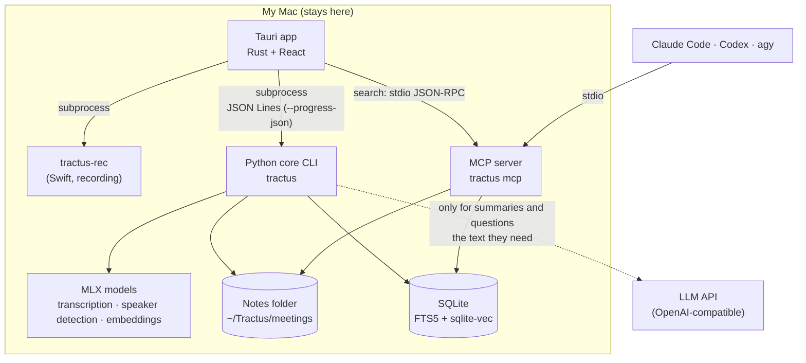

# How it works

[한국어](../how-it-works.md) · **English**

Your notes stay as files in a folder on this Mac, and transcription, speaker detection and search all run on this Mac. Only when you ask for a summary or use Ask AI does the text it needs go to the AI service you chose. The source of truth for design decisions and change history is [ARCHITECTURE.md](../../ARCHITECTURE.md) (Korean).

## Components

The app's Rust side launches the core (`tractus`) and the recorder (`tractus-rec`) as subprocesses and passes the JSON events from their stdout to the UI. `tractus-diar`, the helper for detecting 9 or more speakers, is a separate Swift package in `recorder/diar/` ([recorder/README.md](../../recorder/README.md)). The source of truth for design decisions is [ARCHITECTURE.md](../../ARCHITECTURE.md) (Korean).

## What stays on this Mac and what leaves

| Data | Where it's processed | Does it leave your Mac? |
| --- | --- | --- |
| Audio | Recording, transcription, speaker detection and word sync all on this Mac | No |
| Transcripts, notes, memos | `~/Tractus/meetings/` | Only parts of it, when you request a summary or ask a question (below) |
| Search index, embeddings | SQLite on this Mac | No. **Exception:** if you switch search embeddings to Upstage (`TRACTUS_EMBED=upstage`; the default is this Mac), sentences from your notes (when indexing) and your search queries (when searching) are sent to Upstage |
| Speaker voice profiles | `~/Tractus/voices.json` (0600) | No. They aren't used for search, summaries or Ask AI either |
| Summary requests | The LLM service you chose | Note title, speaker names, transcript (including memos), summary instructions |
| Ask AI requests | The LLM service you chose | Your question, the last 6 messages of the conversation, and the supporting lines. For a single note, the whole note (or the parts found by search if it's over 100,000 characters); across all notes, the top 8 search results and the lines around them. If search finds nothing, the LLM isn't called |
| Downloading models and tools | Hugging Face and others | Uses the internet only while downloading |

- API keys are kept only in the app's settings folder (0600) or in `.env.local`. They never go into logs, commits or your notes folder.
- With `TRACTUS_LOCAL_ONLY=1`, remote LLMs are blocked and only `gemma-local` is allowed.
