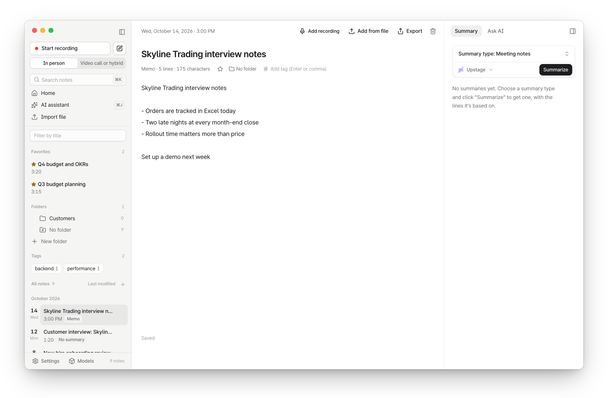

# Usage

[한국어](../usage.md) · **English**

How to create, refine and find notes in the app. Terminal commands are in [CLI](../cli.md) (Korean); installation is in [Setup](setup.md).

<picture>
  <source media="(prefers-color-scheme: dark)" srcset="../images/en/memo-dark.png">
  
</picture>

## In the app

<b>Creating notes</b>

- **Record:** `New note` › `Start recording`. Choose a `Recording mode`: `In person` or `Video call or hybrid` (includes system audio). While recording, you can write memos, press `B` to add a bookmark, and `Pause` and `Resume` (paused time isn't recorded). When you click `Stop recording`, the `After recording` setting decides whether the recording is transcribed on this Mac right away or saved as a note (`Not transcribed`) that you transcribe later with `Transcribe` in the note. By default, Tractus asks each time.
- **Import a file:** `New note` › `Import file`, or drag a file onto the window. Audio and video files are supported. Multiple files are transcribed one after another.
- **Getting started:** The `Get started with Tractus` list on Home walks you through downloading models → the sample note → your first recording → viewing an enhanced note. The sample note is a fictional meeting you can open right away, with no recording or models needed. It already has a transcript, a summary and an enhanced note. It doesn't appear in search or the AI assistant, and you can delete it when you no longer need it. The first time you use a feature, a short tip appears next to it once. You can see the tips again or turn them off in `Settings` › `Help`.
- **Write a memo:** `New note` › `Write` (⌘N). Memos save as you type. A memo is a note like any other, so it can be summarized, used with Ask AI, searched and exported. Positions are shown as `Line 3` instead of a time.
- **Add a recording to a text-only note:** `Add recording` or `Add from file` in the memo header. The note becomes a recording note, and what you wrote moves to the `Memo` tab.
- **Write memos in a recording note:** the `Memo` tab in the side panel. Memos are used as sources for search, Ask AI and summaries.
- **Editing memos:** Text is saved as plain Markdown. Press Enter on a `- `, `1. ` or `- [ ] ` list line to continue the list on the next line; press Enter on an empty list line to end the list. Press ⌘Enter or click `[ ]` to check or uncheck a checkbox. Select text and press ⌘B (bold) or ⌘I (italic). With no text selected, ⌘B collapses the note list.
- **Note titles and memos improve recognition:** When transcribing, words from the note's title, memos during recording and your own memos (for example, `Kubernetes` in the title `Kubernetes migration sync`) are added to that note's custom vocabulary. Writing domain terms in the title or a memo before you record makes the transcript more accurate.

<b>Refining: speakers, transcript, word sync</b>

- In the speaker bar, double-click a name to rename it, or drag it onto another speaker to `Merge speakers`. If you choose `Register this speaker’s voice` while renaming, future recordings will suggest `Is this {name}?`. A voice is biometric data, so only register your own voice or someone who has given consent.
- Double-click a line or press Enter to edit it (Enter saves, Esc cancels). The original text is kept as `Before editing`. Use ⌘F to find and replace. When you correct a misheard term (for example, `Cooper Netties` → `Kubernetes`), Tractus asks `Add to custom vocabulary?`. Click `Add` and it's recognized more accurately from your next recording.
- Consecutive lines from the same speaker are shown together as one paragraph. Times appear when you point at a line.
- Click `Sync words` to highlight the word being played; click a word to play from there. New recordings are synced automatically.
- Player: speed 0.8–2×, `This speaker only`, `Skip silence`, `Clear voice`, volume and mute. `R` replays the current sentence from the start.

<b>Summaries and Ask AI</b>

- **Summary:** the `Summary` tab on the right. From the summary type menu you can choose Brief, To-dos, Lecture notes, Interview or Ideas (you can create several at once). Use `Summarize with your own instructions…` to write your own instructions and save them under `My types` (Settings › `Summary templates`). Every item carries the time of the lines it's based on; click it to jump there. In a recording note, `Send to memo` appends the chosen summary to the end of your memo (to-dos become checkboxes).
- **Switching the transcription engine:** in Settings › Models, pick an engine from the `Transcription engine` dropdown (one you haven't downloaded starts downloading) at the top to transcribe with it (`Automatic` goes back to the engine matched to this Mac). To use a model that isn't listed, enter its Hugging Face repo ID (e.g. `mlx-community/whisper-large-v3-turbo`) under `Add a transcription engine`, then click `Download`. Qwen3-ASR, Whisper and SenseVoice models work; custom vocabulary only applies to Qwen3-ASR. Remove engines you don't use with `Delete`.
- **Minutes:** in a recording note, `Create minutes` in the `Minutes` tab on the right. You get attendees, a discussion summary table, notes per topic (undecided topics are marked `Needs more discussion`), next steps and the next meeting, in a shape that pastes well into a wiki. Owners, teams and due dates are kept only when someone said them, and numbers that don't match the conversation get `Check number`. Double-click a line to edit it (clear it to delete), and click `No owner yet` or `No due date` to fill it in. `Copy` gives the full minutes for a wiki; `Copy short version` gives a short version to send in chat right away (decided, to-dos, not decided yet).
  - To get teams as subjects, add the team to the attendee's name (e.g. `Daniel Kim (Payments)`), or name the speaker after the team.
  - Before the meeting ends, say the to-dos with owners and due dates out loud once; the minutes keep only what was said. Check names, dates and numbers before you send them.
  - Adding your field's terms to `Custom vocabulary` improves both transcription and how terms are written in the minutes.
- **Ask AI:** `Ask AI` on the right answers from this note; ⌘J (`AI assistant` in the sidebar) searches all your notes. Click a time in an answer to jump to the supporting line. If there's nothing to back the answer, it says `No supporting lines`. Before sending, Tractus shows which AI service will receive what.

<b>Finding, organizing, exporting, deleting</b>

- **Search:** ⌘K. Shows word matches and `Similar meaning` results together. Without the smart search model, it finds word matches only.
- **Layout:** Drag the edge of the note list or the side panel to resize it (double-click to reset). Choose the theme and language (`System`, `한국어`, `English`) in `Settings` › `Appearance`.
- **Organizing:** Add a favorite (★), tags (up to 20) and a folder (up to 3 levels deep) from the note header. You can drag notes onto folders in the sidebar, and sort the list by `Last modified`, `Date created`, `Title` or `Length`.
- **Export:** txt, md, srt, vtt, csv (opens directly in Korean Excel), docx, full backup (ZIP: audio + transcript + summary + memo), and PDF (print). Speaker names and your edits are included. Memos can't be exported as srt or vtt.
- **Record from a calendar event:** `Settings` › `Calendar` › `Connect calendar`. Events in progress or starting within 15 minutes appear as cards on Home; click `Record this event` to record with the event title. The event's attendee names help recognition for that recording, and you can pick them with a button when naming speakers. Other accounts such as Google show up too, as long as they're added to macOS Calendar.
- **Send to Obsidian:** `Export` › `Obsidian`. Choose your vault folder once, and each note goes into the vault's `Tractus` folder as a single Markdown file (mirroring your Tractus folder structure). It includes the enhanced note, summaries (to-dos as checkboxes) and the transcript, collapsed. Sending again updates the same file. If the file was edited in Obsidian, Tractus asks before overwriting it. To include audio, turn it on in `Settings` › `Obsidian`.
- **Delete:** `Delete` in the note header moves the note's folder to the macOS Trash. There's no permanent delete.

## Keyboard shortcuts

| Key | Action |
| --- | --- |
| ⌘N | Write (new memo) |
| ⌘K | Search notes |
| ⌘J | AI assistant (ask across all notes) |
| ⌘B | Collapse or expand the note list |
| ⌥⌘B | Collapse or expand the side panel (summary, minutes, Ask AI, memo) |
| ⌘F | Find and replace in the transcript |
| ⌘Z | Undo a transcript edit |
| ⌘S | Save the memo now (it also saves automatically) |
| Space | Play / pause |
| ← → | Skip 5 seconds (10 seconds with Shift) |
| R | Replay the previous sentence |
| ⌘Enter | Check or uncheck a checkbox in a memo |
| ⌘B · ⌘I | Bold · italic for selected text in a memo |
| Shift + , / Shift + . | Slow down / speed up playback |
| B | Bookmark while recording |
