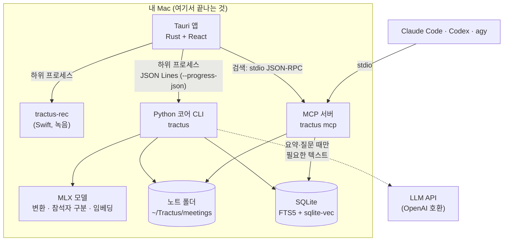

# 동작 방식

노트는 이 Mac의 폴더에 파일로 남고, 변환·참석자 구분·검색은 이 Mac 안에서 돕니다. 요약과 AI 질문을 요청할 때만 필요한 텍스트가 선택한 AI 서비스로 나갑니다. 설계 결정과 변경 이력의 원본은 [ARCHITECTURE.md](../ARCHITECTURE.md)입니다.

## 구성

앱은 Rust가 하위 프로세스로 코어(`tractus`)와 녹음 프로그램(`tractus-rec`)을 띄우고, stdout의 JSON 이벤트를 화면에 전달합니다. 9명 이상 참석자 구분 도우미 `tractus-diar`는 `recorder/diar/`의 별도 Swift 패키지입니다([recorder/README.md](../recorder/README.md)). 설계 결정의 원본은 [ARCHITECTURE.md](../ARCHITECTURE.md)입니다.

## 무엇이 이 Mac에 남고, 무엇이 나가는가

| 데이터 | 처리 위치 | 외부로 나가는가 |
| --- | --- | --- |
| 오디오 | 녹음, 변환, 참석자 구분, 단어 싱크 모두 이 Mac | 나가지 않습니다 |
| 대화 내용, 노트, 메모 | `~/Tractus/meetings/` | 요약·질문 요청 때만 일부 (아래) |
| 검색 색인, 임베딩 | 이 Mac의 SQLite | 나가지 않습니다. **예외:** 검색 임베딩을 Upstage로 고르면(`TRACTUS_EMBED=upstage`, 기본은 이 Mac) 노트의 문장(색인할 때)과 검색어(검색할 때)가 Upstage로 전송됩니다 |
| 참석자 목소리 프로필 | `~/Tractus/voices.json` (0600) | 나가지 않습니다. 검색·요약·AI 질문에도 쓰지 않습니다 |
| 요약 요청 | 선택한 LLM 서비스 | 노트 제목, 참석자 이름, 대화 내용(메모 포함), 요약 지침 |
| AI 질문 요청 | 선택한 LLM 서비스 | 질문, 최근 대화 6개 메시지, 근거 대화. 노트 범위는 그 노트 전체(10만 자가 넘으면 검색된 부분), 전체 범위는 검색 상위 8개와 앞뒤 대화. 검색 결과가 없으면 LLM을 부르지 않습니다 |
| 모델·도구 받기 | Hugging Face 등 | 받을 때만 인터넷을 씁니다 |

- API 키는 앱 설정 폴더(0600) 또는 `.env.local`에만 둡니다. 로그, 커밋, 노트 폴더에는 남기지 않습니다.
- `TRACTUS_LOCAL_ONLY=1`이면 원격 LLM을 막고 `gemma-local`만 허용합니다.
