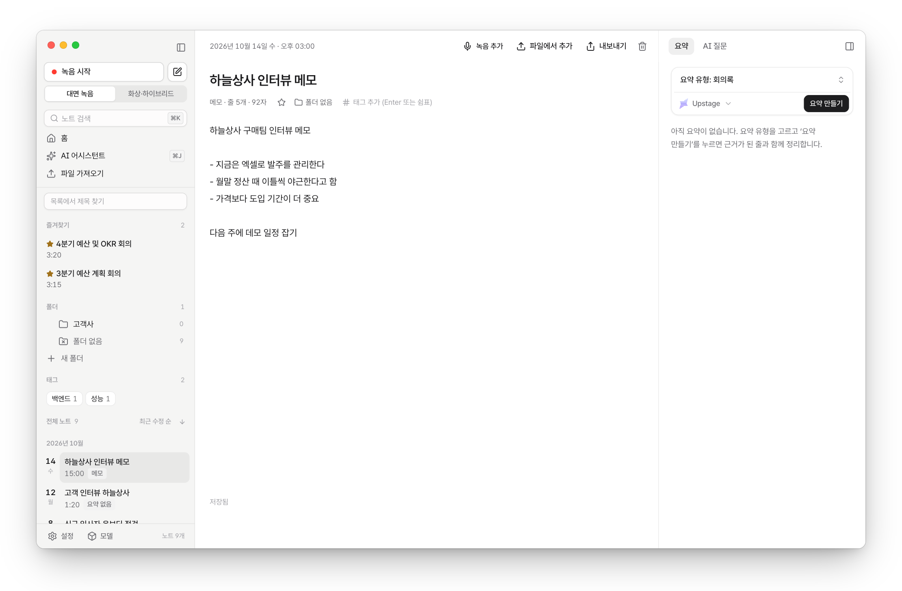

# 사용법

**한국어** · [English](en/usage.md)

앱으로 노트를 만들고 다듬고 찾는 방법입니다. 터미널 명령은 [CLI](cli.md), 설치는 [설치 안내](setup.md)에 있습니다.

<picture>
  <source media="(prefers-color-scheme: dark)" srcset="images/memo-dark.png">
  
</picture>

## 앱에서

<b>노트 만들기</b>

- **녹음:** `새 노트` › `녹음 시작`. 녹음 방식은 `대면 녹음`과 `화상·하이브리드`(시스템 소리 포함) 중에서 고릅니다. 녹음 중에 메모를 쓰거나 `B`로 북마크를 남기고, `일시정지`로 잠시 멈췄다가 `계속`할 수 있습니다(멈춘 시간은 녹음에 들어가지 않습니다). `녹음 종료`를 누르면 설정 `녹음을 끝내면`에 따라 이 Mac에서 바로 텍스트로 바꾸거나, 노트(`변환 전`)로 저장만 해 두었다가 나중에 노트의 `텍스트로 변환`으로 바꿉니다(기본은 끝낼 때마다 묻습니다).
- **파일 가져오기:** `새 노트` › `파일 가져오기`, 또는 창에 파일을 끌어 놓습니다. 오디오와 동영상을 받습니다. 여러 파일은 차례로 변환합니다.
- **처음 시작하기:** 홈의 `Tractus 시작하기` 목록이 모델 받기 → 예시 노트 → 첫 녹음 → 완성된 노트 보기를 차례로 안내합니다. 예시 노트는 녹음·모델 없이 바로 열어 보는 가상 회의라 대화 내용·요약·완성된 노트가 미리 들어 있습니다(검색과 AI 어시스턴트에는 나오지 않고, 필요 없으면 지우면 됩니다). 기능을 처음 쓸 때는 옆에 짧은 안내가 한 번씩 뜹니다. `설정` › `도움말`에서 다시 보거나 끌 수 있습니다.
- **메모 쓰기:** `새 노트` › `글쓰기`(⌘N). 쓰는 대로 저장됩니다. 메모도 같은 노트라서 요약, AI 질문, 검색, 내보내기가 됩니다. 위치는 시각 대신 `3번째 줄`로 가리킵니다.
- **글만 있는 노트에 녹음 붙이기:** 메모 머리의 `녹음 추가` 또는 `파일에서 추가`. 노트가 녹음 노트로 바뀌고 쓴 글은 `메모` 탭으로 옮겨집니다.
- **녹음 노트에 메모 적기:** 오른쪽 패널의 `메모` 탭. 메모는 검색, AI 질문, 요약의 근거가 됩니다.
- **메모 편집:** 글은 Markdown 그대로 저장됩니다. `- `·`1. `·`- [ ] ` 목록 줄에서 Enter를 누르면 다음 줄에 이어지고, 빈 줄에서 Enter를 누르면 목록이 끝납니다. ⌘Enter나 `[ ]`를 눌러 체크박스를 켜고 끕니다. 글자를 고르고 ⌘B(굵게)·⌘I(기울임). 고른 글자가 없을 때의 ⌘B는 노트 목록 접기입니다.
- **노트 제목과 메모가 음성 인식을 돕습니다:** 텍스트로 바꿀 때 노트의 제목·녹음 중 메모·내가 쓴 메모에 있는 낱말(예: 제목 `자원 온톨로지 미팅`의 `온톨로지`)을 그 노트의 자주 쓰는 단어로 함께 넣습니다. 녹음 전에 제목이나 메모에 분야 용어를 적어 두면 더 정확해집니다.

<b>다듬기: 참석자, 대화 내용, 단어 싱크</b>

- 참석자 막대에서 이름을 두 번 눌러 바꾸고, 다른 참석자에 끌어 놓아 `동일 인물로 합치기`를 합니다. 이름 바꿀 때 `이 참석자 목소리 등록`을 고르면 다음 녹음부터 `{이름} 님인가요?`라고 제안합니다. 목소리는 생체정보라서 본인이거나 동의를 받은 사람만 등록하세요.
- 대화를 두 번 누르거나 Enter로 내용을 고칩니다(Enter 저장, Esc 취소). 원문은 `수정 전`으로 남습니다. ⌘F로 찾아 바꿉니다. 잘못 들은 용어를 고치면(예: `언톨로지` → `온톨로지`) `자주 쓰는 단어에 추가할까요?`라고 묻고, `추가`를 누르면 다음 녹음부터 더 정확하게 인식합니다.
- 같은 참석자가 이어서 한 말은 한 문단처럼 붙여 보입니다. 시각은 줄을 가리킬 때 나타납니다.
- `단어 싱크 맞추기`를 누르면 재생 중인 단어가 강조되고 단어를 눌러 그 자리부터 들을 수 있습니다. 새 녹음은 자동으로 맞춥니다.
- 플레이어: 배속 0.8~2배, `이 참석자만 듣기`, `침묵 구간 건너뛰기`, `목소리 선명하게`, 볼륨·음소거. `R`은 지금 듣는 문장을 처음부터 다시 듣습니다.

<b>요약과 AI 질문</b>

- **요약:** 오른쪽 `요약` 탭. `요약 유형` 메뉴에서 핵심 요약, 할 일 중심, 강의·세미나, 인터뷰·면담, 아이디어 정리를 고릅니다(여러 개를 한 번에 만들 수 있습니다). `직접 프롬프트로 요약…`으로 내 요약 방법을 쓰고 `내 유형`으로 저장합니다(설정 › `요약 템플릿`). 모든 항목에 근거 대화의 시각이 붙고, 누르면 그 자리로 이동합니다. 녹음 노트에서는 `메모로 보내기`로 고른 요약을 내 메모 끝에 붙입니다(할 일은 체크박스로).
- **변환 엔진 바꾸기:** 설정 › 모델의 변환 엔진 줄에서 `기본으로 쓰기`를 누르면 그 엔진으로 텍스트로 변환합니다(`자동으로 고르기`로 되돌림). 목록에 없는 모델은 `변환 엔진 직접 추가`에 Hugging Face 저장소 ID(예: `mlx-community/whisper-large-v3-turbo`)를 넣고 `받기`를 누릅니다. Qwen3-ASR·Whisper·SenseVoice 계열을 쓸 수 있고, 자주 쓰는 단어는 Qwen3-ASR 계열에서만 쓰입니다. 쓰지 않는 엔진은 `삭제`로 지웁니다.
- **회의록:** 녹음 노트의 오른쪽 `회의록` 탭에서 `회의록 만들기`. 참석, 논의 사항 요약 표, 안건별 논의(정하지 못한 안건은 `추가 논의 필요`), 향후 예정 작업, 다음에 볼 날을 사내 위키에 붙이기 좋은 모양으로 정리합니다. 담당·팀·기한은 대화에서 말한 것만 남기고, 대화와 다른 숫자에는 `숫자 확인`이 붙습니다. 줄을 두 번 눌러 고치고(비우면 지움), `담당 미정`·`기한 미정`을 눌러 채웁니다. `복사`는 위키용 전체, `짧게 복사`는 메신저로 바로 보낼 짧은 판(정한 것·할 일·아직 안 정한 것)입니다.
  - 팀이 주어로 나오게 하려면 참석자 이름에 팀을 붙이세요(예: `김지훈 (정산팀)`, 또는 이름을 `기획팀`으로).
  - 회의가 끝나기 전에 할 일과 담당·기한을 소리 내어 한 번 정리하면 회의록에 그대로 남습니다(말한 것만 남기 때문입니다). 사람 이름·날짜·숫자는 보내기 전에 한 번 확인하세요.
  - 분야 용어를 `자주 쓰는 단어`에 넣으면 변환과 회의록 표기가 함께 좋아집니다.
- **AI 질문:** 오른쪽 `AI 질문`은 이 노트 내용으로, ⌘J(사이드바 `AI 어시스턴트`)는 모든 노트에서 찾아 답합니다. 답 속 시각을 누르면 근거 대화로 이동하고, 근거가 없으면 `근거 대화 없음`으로 알려 줍니다. 보내기 전에 어느 AI 서비스로 무엇이 전송되는지 안내합니다.

<b>찾기, 정리, 내보내기, 삭제</b>

- **검색:** ⌘K. 단어 일치와 `비슷한 뜻`을 함께 보여 줍니다. 스마트 검색 모델이 없으면 단어 일치로만 찾습니다.
- **화면:** 노트 목록과 오른쪽 패널의 경계를 끌어 폭을 바꿉니다(두 번 누르면 기본 폭). `설정` › `화면`에서 테마와 언어(`시스템 설정`·`한국어`·`English`)를 고릅니다.
- **정리:** 노트 머리에서 즐겨찾기(★), 태그(20개까지), 폴더(3단계까지)를 붙입니다. 사이드바에서 폴더로 끌어 놓을 수 있고, 목록은 `최근 수정 순`·`만든 순`·`제목 순`·`길이 순`으로 봅니다.
- **내보내기:** txt, md, srt, vtt, csv(한국어 Excel에서 바로 열림), docx, 전체 백업(ZIP: 오디오 + 대화 내용 + 요약 + 메모), PDF(인쇄). 참석자 이름과 고친 내용이 반영됩니다. 메모 노트는 srt·vtt로 내보낼 수 없습니다.
- **캘린더 일정으로 녹음:** `설정` › `캘린더` › `캘린더 연결`. 진행 중이거나 15분 안에 시작하는 일정이 홈에 카드로 보이고, `이 일정으로 녹음`을 누르면 일정 제목으로 녹음합니다. 일정의 참석자 이름은 그 녹음의 음성 인식을 돕고, 참석자 이름을 정할 때 버튼으로 고를 수 있습니다. Google 등 다른 계정도 macOS 캘린더에 추가돼 있으면 보입니다.
- **Obsidian으로 보내기:** `내보내기` › `Obsidian`. 처음 한 번 볼트 폴더를 고르면 노트가 볼트의 `Tractus` 폴더에 Markdown 하나로 들어갑니다(Tractus 폴더 구조 그대로). 완성된 노트, 요약(할 일은 체크박스), 접힌 대화 내용이 들어가고, 다시 보내면 같은 파일을 고쳐 씁니다. Obsidian에서 고친 파일은 덮어쓰기 전에 묻습니다. 오디오도 넣으려면 `설정` › `Obsidian`에서 켭니다.
- **삭제:** 노트 머리의 `삭제`는 폴더를 macOS 휴지통으로 옮깁니다. 영구 삭제는 없습니다.

## 단축키

| 키 | 동작 |
| --- | --- |
| ⌘N | 글쓰기 (새 메모) |
| ⌘K | 노트 검색 |
| ⌘J | AI 어시스턴트 (모든 노트에 질문) |
| ⌘B | 노트 목록 접기·펼치기 |
| ⌥⌘B | 오른쪽 패널(요약·회의록·AI 질문·메모) 접기·펼치기 |
| ⌘F | 대화 내용에서 찾아 바꾸기 |
| ⌘Z | 대화 내용 수정 되돌리기 |
| ⌘S | 메모 바로 저장 (평소에도 자동 저장) |
| Space | 재생 / 일시정지 |
| ← → | 5초 이동 (Shift와 함께 10초) |
| R | 직전 문장 다시 듣기 |
| ⌘Enter | 메모에서 체크박스 켜고 끄기 |
| ⌘B · ⌘I | 메모에서 고른 글자 굵게 · 기울임 |
| Shift + , / Shift + . | 배속 내리기 / 올리기 |
| B | 녹음 중 북마크 |
